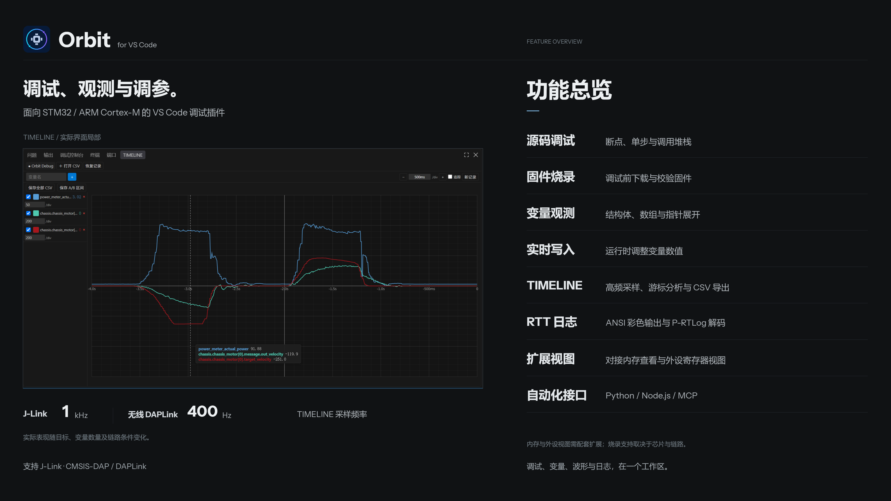
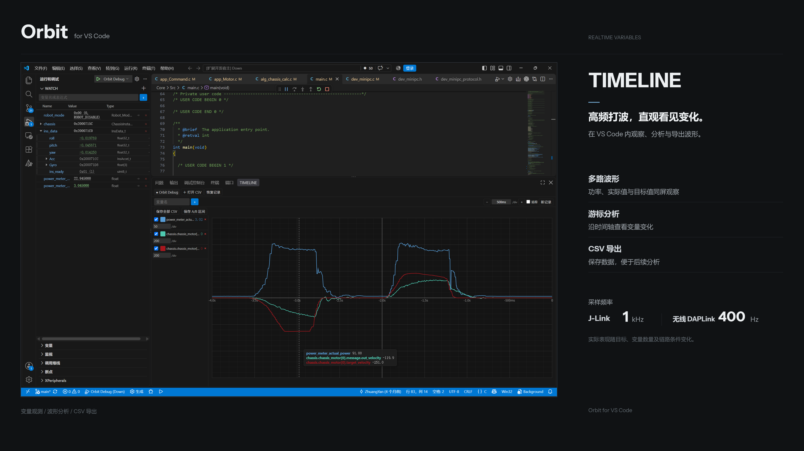
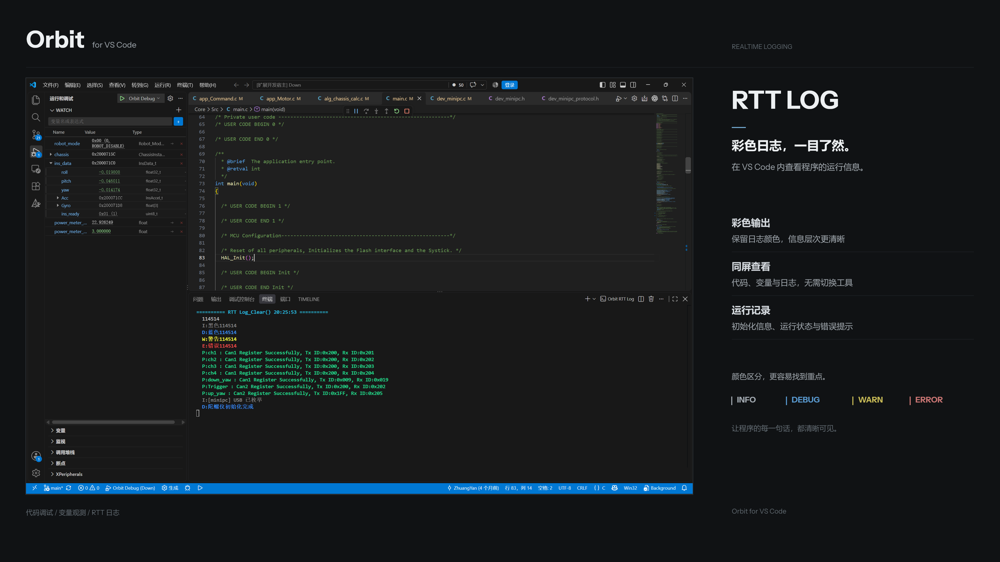

<p align="center">
  <a href="https://marketplace.visualstudio.com/items?itemName=orbit-debug.orbit-for-vscode"></a>
</p>

<h1 align="center">Orbit — The Debugger for What’s Next</h1>

<p align="center">
  在 VS Code 里调试 STM32 / ARM Cortex-M，支持 J-Link、DAPLink 和 RMLink。<br>
  直接读 MCU 变量画波形，运行中在 Watch 不停机改参，无需写串口通信代码。<br>
  断点、单步、RTT 日志、内置 FreeRTOS 与 SystemView 诊断都在这里，AI 也可通过 MCP 操作调试器。
</p>

<p align="center">
  <a href="https://marketplace.visualstudio.com/items?itemName=orbit-debug.orbit-for-vscode">插件市场安装</a> ·
  <a href="https://github.com/zhuangyan114/Orbit/releases">离线下载</a> ·
  <a href="https://github.com/zhuangyan114/Orbit/blob/master/README.md#开始使用">快速开始</a> ·
  <a href="https://github.com/zhuangyan114/Orbit/blob/master/Releases/docs/全套工具链教程.md">从零搭环境</a> ·
  <a href="https://github.com/zhuangyan114/Orbit/blob/master/Releases/docs/user-guide.md">用户手册</a> ·
  <a href="https://github.com/zhuangyan114/Orbit/blob/master/Releases/docs/RTOS诊断功能使用教程.md">RTOS 诊断教程</a> ·
  <a href="https://github.com/zhuangyan114/Orbit/blob/master/Releases/docs/user-guide.md#12-mcp-与-plugin-api">MCP 接入</a> ·
  <a href="https://github.com/zhuangyan114/Orbit/issues">反馈问题</a>
</p>

[](https://github.com/zhuangyan114/Orbit/blob/master/resources/orbit-feature-overview-promo.png)

## 功能

### TIMELINE 高频波形

- **通过 J-Link / DAPLink / RMLink 直接采样 MCU 变量**，不需要专门的波形上报代码，也不额外占用串口。
- 支持多变量曲线、多分组标签（可新建、重命名、拖动排序与按组勾选采样）、左侧变量拖动排序、时间窗口缩放、游标读数和 CSV 导出。
- Watch 和 Timeline 输入框留空时，点击右侧蓝色 **+** 打开共用的变量选择编辑器：按源文件分组，用五列表格搜索、展开和多选变量，也可取消勾选已有变量；点击「添加」应用增删，关闭不保存。未调试时也可解析工程 ELF，Timeline 只可新增数值叶子变量，颜色跟随 VS Code 主题。
- A/B 时间游标测量时间差（左键放置、右键删除单个、中键同时清除），可保存全部数据或游标区间，再通过 CSV 和多个标签页回看；长期记录持续写盘，查看历史时实时采集继续。
- 坐标格上方显示实时采样率；调试结束、打开 CSV 或恢复记录后显示平均采样率。支持回看超过十分钟的数据，时间比例最大为 **100 s/div**。
- **J-Link 采样可达 1 kHz，无线 DAPLink 有约 400 Hz 的使用记录**；支持 RMLink 板端订阅与可选 XR-DAP 探针端采样（`cmsisDapXrSampling: true`）。实际速率取决于目标、表达式数量和并行负载。

[](https://github.com/zhuangyan114/Orbit/blob/master/resources/orbit-timeline-promo.png)

采样率指变量读取速率，不是界面刷新率。具体配置和结果见[无线 DAPLink 对照记录](https://github.com/zhuangyan114/Orbit/blob/master/docs/cmsis-dap-v1-v2-timeline-2026-10-02.md)。

### Watch 变量读写

- 查看变量和表达式，展开结构体、数组与指针，支持多分组管理与数值变化高亮。
- **支持运行中不停机直写（Live Write）**：直接修改可写变量而无需暂停 MCU，避免打断实时控制中断、PWM 输出或触发看门狗；CMSIS-DAP 采用原生 8/16/32-bit MEM-AP CSW 写入，消除子字变量与 CPU 并发修改的竞态。

### 源码调试与固件烧录

- 支持断点、单步、暂停、继续、复位和调用堆栈。
- **自动查找 ELF/AXF**，通常只需在 `launch.json` 中指定芯片型号。
- 启动前可自动烧录并校验固件：J-Link 覆盖 SEGGER 器件库；DAPLink 与 RMLink 优先使用已登记型号的快速烧录算法，其余常见 STM32 F1 / F4 / H72x / G0 / G4 型号由随扩展提供的 OpenOCD 按 `device` 自动烧录，无需单独安装配置 OpenOCD。

### RTT 彩色日志

- 在 `Orbit RTT Log` 终端显示日志，保留 ANSI 颜色，也可输出到 Debug Console。
- 支持 P-RTLog 二进制日志解码，读取 ELF 中的 token 信息；统一 RTT 通道可与 SystemView 二进制流共存。

[](https://github.com/zhuangyan114/Orbit/blob/master/resources/orbit-rtt-promo.png)

日志需要固件接入 RTT；P-RTLog 解码需要匹配的固件和 ELF 信息。接法和配置见[用户手册](https://github.com/zhuangyan114/Orbit/blob/master/Releases/docs/user-guide.md)。

### RTOS 诊断与 SystemView Trace

- **内置底部 RTOS 面板**：直接复用当前活动调试连接（支持 J-Link、DAPLink 与 RMLink），无需安装第三方 `mcu-debug.rtos-views` 扩展。
- **FreeRTOS 内核快照（Tasks & Objects）**：从 ELF DWARF 信息自动推导内核结构偏移，查看任务状态、优先级（含互斥锁优先级继承）、按需栈高水位、CPU 占比、队列/互斥锁/信号量、候选死锁等待环、软件定时器及 `heap_4` 堆概览。
- **SEGGER SystemView 全链路分析**：固件接入 SystemView 后，支持 Continuous / Single-Shot / Post-Mortem 三种录制模式、任务与中断泳道时间线、CPU 负载分箱图（点击下钻）与上下文/Ready 延迟统计、Markers、百万级事件列表与 FreeRTOS API 参数解码、Trace 终端、与变量 TIMELINE 跨面板时间联动，以及 `orbit-trace-v1` 离线归档回放和 `.bin` / 39 列 `.csv` 导出。

接入步骤与排查流程见 [RTOS 诊断功能使用教程](https://github.com/zhuangyan114/Orbit/blob/master/Releases/docs/RTOS诊断功能使用教程.md)。

### MCP 与 AI 自动调试

- 提供 Python、Node.js 和 MCP 接口，支持变量读写、波形记录、断点管理、调试控制以及 RTOS 快照与 SystemView Trace 查询/录制。
- **AI 可通过 MCP 实际操作调试器，自动执行已配置、已授权的调试流程。**
- 脚本和 AI 复用当前调试连接，不另开连接抢占探针。

自动化接口默认关闭；开启后默认只开放只读权限，控制、写入和烧录等操作需要手动授予对应权限。配置方法见 [MCP 接入指南](https://github.com/zhuangyan114/Orbit/blob/master/Releases/docs/user-guide.md#12-mcp-与-plugin-api) 和 [Automation API 文档](https://github.com/zhuangyan114/Orbit/blob/master/docs/api/orbit-automation-api.md)。

### 内存与外设视图

兼容 Memory View、Peripheral Viewer，查看内存和外设寄存器；需要另外安装对应扩展。

**Orbit 的差异在于 VS Code 内使用、兼容 J-Link、DAPLink 与 RMLink，并支持 MCP 自动化。** [Ozone](https://www.segger.com/products/development-tools/ozone-j-link-debugger/technology/tool-overview/) 已有 Watch、变量修改和波形采样，上限更高，但不支持 DAPLink；[VOFA+](https://www.vofa.plus/docs/learning/) 通过串口或网络接收上报数据，Orbit 则通过探针直接读取变量。

## 开始使用

### 准备这些东西

| 你需要 | 说明 |
| --- | --- |
| Windows x64 + VS Code | 当前发布目标是 Windows；VS Code 需要 1.90.0 及以上的 1.x 版本 |
| STM32 / ARM Cortex-M 开发板 | 芯片和探针组合需要在支持范围内，尤其是 CMSIS-DAP / RMLink 烧录 |
| J-Link、CMSIS-DAP / DAPLink 或 RMLink | J-Link 需要安装 SEGGER 软件包；CMSIS-DAP v1 使用 HID，v2 使用 WinUSB，亦支持 `tcp` 网络探针；RMLink 需运行 RMLink 连接服务 |
| 带调试信息的 ELF/AXF | Orbit 负责调试，不替你编译固件；先确认工程能编译 |
| GNU Arm 工具链 | 确保 `arm-none-eabi-nm`、`arm-none-eabi-objdump`、`arm-none-eabi-addr2line` 可用，建议加入 `PATH` |

如果你还没有完整的 VS Code + ARM GCC + CMake 环境，先看[全套工具链教程](https://github.com/zhuangyan114/Orbit/blob/master/Releases/docs/全套工具链教程.md)，不用在这里猜该装什么。

### 安装，然后按 F5

1. 在 VS Code 扩展页搜索 **Orbit STM32 Debugger**，选择扩展 ID 为 `orbit-debug.orbit-for-vscode` 的插件安装，也可以直接打开[插件市场页面](https://marketplace.visualstudio.com/items?itemName=orbit-debug.orbit-for-vscode)。需要离线安装时，从 [Releases](https://github.com/zhuangyan114/Orbit/releases) 下载 VSIX，再执行 `Extensions: Install from VSIX...`。安装后重新加载窗口。
2. 打开固件工程文件夹，编译得到 ELF/AXF，连接开发板和探针。
3. 在“运行和调试”中点击 **“创建一个 launch.json 文件”**，选择 **Orbit (J-Link / CMSIS-DAP / RMLink)**。Orbit 会生成最小配置，只需填写 `device` 芯片型号，ELF/AXF 文件会自动查找。已有 `launch.json` 时，也可通过“添加配置”选择 **Orbit: 最小调试配置**。下面用 STM32F407IG 举例：

```jsonc
{
  "version": "0.2.0",
  "configurations": [
    {
      "name": "Orbit Debug",
      "type": "orbit",
      "request": "launch",
      "device": "STM32F407IG"
    }
  ]
}
```

4. 选择 `Orbit Debug`，按 **F5**。连上后，先打一个断点、读一个变量，再打开 TIMELINE 试一条曲线。

**默认启动前会烧录固件。** 只想调试板子里现有的程序时，加上 `"flashBeforeDebug": false`，并确保 ELF 与板上固件一致。

J-Link、DAPLink 和 RMLink 烧录后默认停在 `main`。可在 `launch.json` 中用 `"runToEntryPoint": "app_main"` 指定其他入口函数，或用 `false` 禁用入口停靠。点击重启时，ELF 内容未变化则复位后直接运行，仍会响应用户断点；ELF 变化后重新烧录并停在配置的入口。`flashBeforeDebug: false` 始终跳过烧录。

通常不需要填写 `program`：Orbit 会依次在 `build/Debug`、`build/Release`、`build` 中自动查找 ELF/AXF。工程里有多个固件，或输出到其他目录时，也可以用 `program` 手动指定。

默认优先选择 J-Link；两种探针都插着、但你想用 DAPLink 时，加上 `"probe": "cmsis-dap"`；使用 RMLink 连接服务时加上 `"probe": "rmlink"`（多台在线设备时再指定 `"rmlinkDeviceId"`）。CMSIS-DAP 默认优先 v2 WinUSB，也兼容 v1 HID，并支持 `"cmsisDapTransport": "tcp"` 与可选的 `"cmsisDapXrSampling": true`。更多配置见[用户手册](https://github.com/zhuangyan114/Orbit/blob/master/Releases/docs/user-guide.md)。

## 限制与已知问题

Orbit 主要由个人维护，手头开发板和探针有限，目前仅覆盖了常用型号与常见场景：

- **仅支持 Windows x64**：暂不提供 macOS / Linux 版本。
- **CMSIS-DAP / RMLink 烧录**默认优先使用已登记型号的快速算法。更多 STM32 型号可根据 `device` 用内置 OpenOCD 烧录片内 Flash，`"flashBackend": "openocd"` 可显式选用。只调试板上已有固件时设置 `"flashBeforeDebug": false`。支持范围见[用户手册](https://github.com/zhuangyan114/Orbit/blob/master/Releases/docs/user-guide.md)。
- **复杂表达式与局部变量**：表达式类型和地址依赖 ELF/DWARF 调试信息，局部变量只在暂停且对应栈帧有效时可读取；高频采样建议优先使用全局变量或简单成员表达式。
- **采样与日志带宽共享**：展开大量 Watch 变量或高负载 RTT 输出会占用探针带宽；高速采样期间 RTT 文本轮询会自动暂停，采样结束后恢复。
- **RTOS 诊断范围**：内置 RTOS 面板目前面向单核 ARM Cortex-M FreeRTOS；运行态快照和跨面板时间联动会标明各自的可靠性边界；Trace 离线归档采用 `orbit-trace-v1` 目录、`.bin` 和 `.csv`，暂不支持 `.SVDat` 导入导出。详见 [RTOS 诊断功能使用教程](https://github.com/zhuangyan114/Orbit/blob/master/Releases/docs/RTOS诊断功能使用教程.md)。

遇到问题欢迎提 [Issue](https://github.com/zhuangyan114/Orbit/issues)。反馈时请尽量附上芯片型号、探针类型、Orbit 版本、`launch.json`、复现步骤和 `outputs/Log/` 下的相关日志（注意删掉个人路径等敏感信息），方便快速定位。

## 欢迎加入

Orbit 还有不少要打磨的地方。手头开发板有限，CMSIS-DAP 内置快速烧录算法目前只覆盖了部分常用型号（其余常见 STM32 已支持通过内置 OpenOCD 自动烧录）。

如果你想为更多芯片适配 CMSIS-DAP 原生快速烧录算法，从[新芯片适配指南](https://github.com/zhuangyan114/Orbit/blob/master/.agent/skills/cmsis-dap-add-target/SKILL.md)开始。


## 文档和开发

| 想做什么 | 去哪里看 |
| --- | --- |
| 从 Keil 等环境转到 VS Code | [全套工具链教程](https://github.com/zhuangyan114/Orbit/blob/master/Releases/docs/全套工具链教程.md) |
| 查 Watch、TIMELINE、RTT、烧录和配置 | [用户手册](https://github.com/zhuangyan114/Orbit/blob/master/Releases/docs/user-guide.md) |
| 用 FreeRTOS 快照与 SystemView Trace | [RTOS 诊断功能使用教程](https://github.com/zhuangyan114/Orbit/blob/master/Releases/docs/RTOS诊断功能使用教程.md) |
| 接 Python / Node.js / MCP | [Automation API](https://github.com/zhuangyan114/Orbit/blob/master/docs/api/orbit-automation-api.md) |
| 看实现结构 | [架构说明](https://github.com/zhuangyan114/Orbit/blob/master/docs/architecture.md) |
| 看测试到了哪一步 | [自动化与硬件验收](https://github.com/zhuangyan114/Orbit/blob/master/docs/api/orbit-automation-hardware-acceptance.md) |
| 看各版本更新 | [更新日志](https://github.com/zhuangyan114/Orbit/blob/master/CHANGELOG.md) |
| 查已确认的修复 | [修复记录](https://github.com/zhuangyan114/Orbit/blob/master/docs/bug-fix-log.md) |

<details>
<summary>从源码构建</summary>

除 Node.js / npm 外，Native helper 构建还需要 CMake 3.20+ 和 Windows C++ 编译环境（Visual Studio C++ 工具或 x64 MinGW-w64）。

```powershell
npm install
npm run build:openocd
npm run build
npm run build:native
npm run typecheck
npm test
```

启动扩展开发窗口可执行 `npm run dev`。源码位于 `src/` 和 `native/`，请勿直接修改生成的 `dist/` 文件。`npm run build:openocd` 会校验并解压 `resources/openocd/` 中固定的 OpenOCD Windows 运行时到 `out/openocd/`。

</details>

## 许可证

- Orbit 扩展本身采用 [MIT](https://github.com/zhuangyan114/Orbit/blob/master/LICENSE) 许可证。
- 自 `1.2.3` 起，随 Orbit 分发的内置 OpenOCD Windows 运行时（`resources/openocd/` 与 `out/openocd/`）为未经修改的上游 OpenOCD `0.12.0+dev-g6fbe9e7` 二进制及附带动态库，遵循 **GNU GPL-2.0-or-later**（以及 `libjaylink` `GPL-2.0-or-later`、`libftdi1` `LGPL-2.1-only`、`libusb-1.0` `LGPL-2.1-or-later`、`hidapi`、`libgcc` 等各自开源许可）。Orbit 仅在独立烧录阶段通过命令行子进程按需调用 `openocd.exe`，未链接或合入任何 GPL 代码。对应许可证文本、上游固定源码提交及三年有效书面源码要约见 [OpenOCD 运行时说明](https://github.com/zhuangyan114/Orbit/blob/master/resources/openocd/README.md)、[OpenOCD COPYING](https://github.com/zhuangyan114/Orbit/blob/master/resources/openocd/COPYING) 与 [第三方开源声明](https://github.com/zhuangyan114/Orbit/blob/master/THIRD_PARTY_NOTICES.md)。
- SEGGER J-Link 软件包、RMLink 连接服务等外部依赖仍遵循各自的许可协议。
