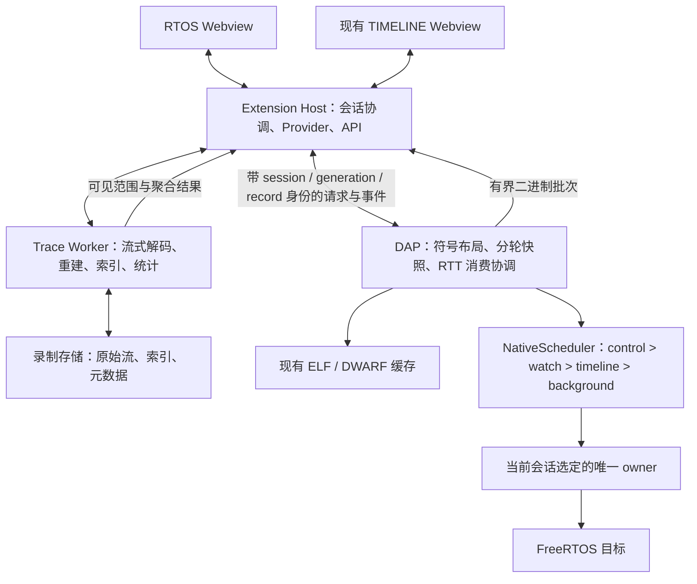

# Orbit RTOS / SystemView 开发总计划

- 编写日期：2026-11-18（Asia/Shanghai）。
- 状态：阶段 0 离线准备已开始；快照与 Trace 功能开发尚未开始，阶段状态见第 12 节。
- 适用项目：Orbit for VS Code，Windows。
- 首版范围：仅支持和验证 FreeRTOS；其他 RTOS 全部放到首版之后。
- 执行规则：按小部分实施，每部分完成相应检查后独立提交 Git，提交信息使用中文。
- 文档定位：本项目的开发入口和总验收依据。后续详细设计、实验结果、兼容矩阵和阶段记录均由本计划索引。

## 1. 目标、依据与已确定的决定

在 Orbit 内建一套 RTOS 观测与事件分析功能：用户只有 ELF/DWARF 时，可以查看 FreeRTOS 任务和可发现的内核对象；固件接入标准 SystemView 记录组件后，可以录制任务切换、中断、Ready 等待及用户事件，并分析时间和负载。

采用反重力在 2026-11-17 编写的《Orbit 自研 RTOS View + SystemView 替代方案调研与架构设计报告》作为需求和技术路线输入。本计划将其整理为实施顺序、工程约束与验收条件，后续接手者无需读取原聊天即可执行。

### 1.1 已确定的决定

| 编号 | 决定 | 执行要求 |
|---|---|---|
| D1 | 快照和 Trace 双引擎 | 先交付 FreeRTOS 内存快照，再接入 SystemView 事件流；快照可以独立使用。 |
| D2 | 独立底部 RTOS 面板 | 与现有 WATCH、TIMELINE 并列；面板内部提供 Tasks & Objects、Trace Timeline、Contexts & Events。 |
| D3 | 替换外部 RTOS Views 集成 | 内建快照视图通过后清理 `mcu-debug.rtos-views` 的专属接入，保留其他 Viewer 及标准 DAP 能力。 |
| D4 | 首版仅 FreeRTOS | 含选定测试工程中的原生 FreeRTOS、CMSIS-RTOS v1/v2 包装；支持声明必须写明实际验证的内核版本和配置。 |
| D5 | 兼容标准 SystemView 固件协议 | 以指定版本的官方资料、目标端源码和独立样本建立协议依据；逐项声明支持的事件和录制模式。 |
| D6 | 复用现有目标连接 | 快照、Trace、RTT Log、Watch、Timeline 均使用当前会话选定的 owner 和调度器。 |
| D7 | 按小部分提交 | 一个小部分对应一个可审查、可验证的提交；代码、必要测试、相关文档和进度一起提交。 |

### 1.2 原报告中需要转化为验证工作的内容

原报告中的“1～3 次批量读取”“暂停态小于 20 ms”“50 倍提速”“百万事件 60 fps”“100% 协议兼容”“微秒级跨面板对齐”均作为设计目标或待验证假设，不能直接写成当前能力。

- 链表的后继地址依赖前一轮读取结果，任务越多、链表越深，读取轮次可能增加。按实际拓扑分轮、合批和让步，不为了固定轮数扩大读区或猜地址。
- 快照基础信息尽量无需修改固件；CPU 统计、对象名称、完整栈边界等依赖已有符号、配置或注册信息。缺少条件时逐字段说明原因。
- 运行态快照可能跨越调度和对象变化，不能将多轮读取得到的内容称为原子快照。
- SystemView 线上事件协议、目标端记录模式和 `.SVDat` 文件容器分别验证；能解码 RTT 字节流不代表能互开官方文件。
- 读取普通 RTT 环形流通常需要推进目标端读指针；Trace Start/Stop 也可能写 Down-buffer。因此 Trace 采集不能笼统归类为“只读目标”。
- 主机接收时间、探针采样时间和目标 Trace 时间属于不同钟域。跨面板精确对齐必须有测得的映射和误差范围。

## 2. 首版交付范围与功能边界

### 2.1 首版必须交付

| 能力 | 首版交付内容 | 必要条件或边界 |
|---|---|---|
| FreeRTOS 识别 | 自动探测、手动指定、能力说明、缺少符号的诊断 | 单核 Cortex-M、ARM GCC ELF/DWARF；具体版本与 port 在阶段 0 冻结。 |
| 任务快照 | TCB 地址、名称、状态、当前运行任务、优先级、可用时的基础优先级和运行时间 | 暂停态与运行态刷新；保留未知、部分和过期状态。 |
| 栈信息 | 栈起点、已知边界、可计算时的容量与水位 | 按需或低频扫描；不将当前 SP 差值当作历史峰值，不猜未知栈长度。 |
| CPU 统计 | 有运行时统计计数器时计算任务区间占比 | 无计数器显示不可用；不能用低频采样命中次数伪装成精确 CPU%。 |
| 内核对象 | 可发现的 Queue、Mutex、Semaphore、Software Timer，以及可用的 Heap 概览 | 展示对象来源和覆盖范围；未注册、无符号或无可遍历入口的对象允许不可见。 |
| 锁与等待关系 | 已知对象的持有者、可解析的等待任务、可能的等待环 | 必须携带快照一致性和证据；运行态单帧不能直接判定死锁。 |
| RTT 传输 | 发现 SysView Up/Down 通道、二进制读取、控制命令写入、与文本 RTT 隔离 | 按通道元数据匹配，不能固定为 Channel 1；同一消费通道只有一个读取者。 |
| Trace 录制 | Continuous、Single-Shot、Post-Mortem 的采集与状态说明 | 后两者要求目标端具备对应记录模式及可验证的缓冲区元数据。 |
| Trace 展示 | 任务/ISR 执行区间、Ready 等待、事件定位、基础 Markers、A/B 游标 | Scheduler/Timer 专属泳道仅在事件能可靠区分时展示。 |
| 分析视图 | Contexts、CPU Load、Events、Terminal、基础 Marker 耗时统计 | 缺口区间不能计入完整统计；只对已覆盖的事件语义作解释。 |
| 保存和回放 | 原始流与元数据保存、离线回放、选区/事件 CSV；`.SVDat` 互操作专项 | Orbit 自有归档必须可回放；官方容器格式通过专项门槛后才声明兼容。 |
| Timeline 联动 | 同记录关系下的选区/游标联动；时间映射质量可见 | 基础联动必做；精确同步只在完成钟域校准的路径启用。 |
| 自动化 | 快照、能力查询、Trace 状态/启停、分页事件及统计接口，配套 MCP | 沿用现有 API 身份、认证、权限和目标操作边界。 |

首版交付是阶段 0～6 全部完成。阶段 2 完成可交付一次 FreeRTOS 快照预览版，阶段 4 完成可交付一次 Trace 预览版；预览版需要列出缺失功能和未验收项，不能标为首版完成。

### 2.2 首版之后再做

- RT-Thread、Zephyr、ThreadX、RTX5、embOS 等其他内核；首版不加入其探测器、描述表或验收任务。
- FreeRTOS SMP、多核关联、TrustZone 安全侧完整上下文，以及未进入首版矩阵的架构、编译器和 port。
- Heap 分配/释放全量追踪、泄漏候选与碎片分析；首版 Heap 概览不等于这些能力。
- 高级 Marker 分布分析、复杂用户扩展事件编辑器、长期多记录对比。
- `orbit_sysview_mini.h` 轻量发射器。先完成标准固件接入，后续单独验证协议、FreeRTOS hooks、时间戳、临界区与固件开销，不能承诺只加一个 include 即完成接入。

### 2.3 目标与探针矩阵

首版基准板建议采用已有开发条件下的 STM32F407VET6 单核 Cortex-M4；阶段 0 确认实际板卡和工程，记录完整配置后冻结。不能把该基线扩写为全部 STM32 或全部 FreeRTOS 版本均支持。

| 路径 | 首版要求 | 发布声明 |
|---|---|---|
| J-Link native | 快照、RTT 多通道、Trace 三种录制模式、调试并发和断线验收 | 必须有实际板卡证据。 |
| CMSIS-DAP WinUSB | 快照、RTT 多通道、Trace 录制和调试并发 | 必须有实际板卡证据；吞吐单独测量。 |
| CMSIS-DAP HID | 快照、缓冲读取模式、低带宽行为与能力提示 | 连续 Trace 超预算时明确降级；不保证所有事件速率均可持续。 |
| J-Link legacy | 保留原功能；新功能按已实现 capability 暴露 | 未实现的 Trace 能力明确不可用，不创建 native owner 补齐。 |
| 已有 RMLink / TCP / XR 路径 | 保留现有行为，按当前 owner capability 接入 | 首版不以新增无线能力为前置；未实测的快照/Trace 路径标为未验收。 |

探针不足时可以继续离线开发，但首版所需硬件项目仍保留为未完成。调整发布矩阵必须更新本计划并说明原因，不能用 mock 通过替代。

## 3. 当前代码基线与计划架构

### 3.1 当前可复用的位置

以下为编写计划时的代码入口，开始每部分前仍需核对当前工作树和对应测试。现有入口表示可复用的基础，不表示本计划功能已经完成。

| 位置 | 当前职责 | 本计划的使用方式 |
|---|---|---|
| [`src/debug/dap-session.ts`](../../src/debug/dap-session.ts) | 会话、目标访问协调、RTT 轮询、`rtosInfo` 与标准 DAP | 增加有身份约束的快照/Trace 请求和事件；保持标准变量与内存协议。 |
| [`src/ozone-backend/jlink-symbols.ts`](../../src/ozone-backend/jlink-symbols.ts) | 符号、DWARF 类型、字段偏移等 | 复用并补齐必要布局能力，按 ELF 身份缓存，禁止另建一套 ELF/DWARF 解析器。 |
| [`src/ozone-backend/session-target-channel.ts`](../../src/ozone-backend/session-target-channel.ts) | owner 选择、统一内存等能力 | 新能力通过选定 owner 转发；不能由 RTOS 模块自行连接探针。 |
| [`src/ozone-backend/native-scheduler.ts`](../../src/ozone-backend/native-scheduler.ts) | 串行目标访问、优先级、取消与合并 | 快照与 RTT 分片作为 background；保留完整 control 临界区。 |
| [`src/ozone-backend/cpp-jlink-channel.ts`](../../src/ozone-backend/cpp-jlink-channel.ts) | J-Link helper 协议与调度 | 同步新增 capability、结果和错误定义。 |
| [`src/ozone-backend/cmsis-dap-helper-channel.ts`](../../src/ozone-backend/cmsis-dap-helper-channel.ts) | CMSIS-DAP helper 协议 | 同步 RTT 枚举/写入等能力，并保持传输错误语义。 |
| [`native/jlink-helper/src/main.cpp`](../../native/jlink-helper/src/main.cpp) | J-Link DLL、批量读、RTT | 复用当前 DLL owner；批次上限和原生临界区需进入读计划预算。 |
| [`native/cmsis-dap-helper/src/segger_rtt.cpp`](../../native/cmsis-dap-helper/src/segger_rtt.cpp) | 内存型 RTT 读取、描述符与读指针更新 | 扩展合法内存区间、通道发现和 Down-buffer 写入。 |
| [`src/plugin-api/runtime-router.ts`](../../src/plugin-api/runtime-router.ts) | 活动 DAP 会话路由 | API 与 MCP 通过当前会话访问，失败时不回落到另一个 backend。 |
| [`src/webview/timeline`](../../src/webview/timeline) | 现有时间轴、Canvas、游标、范围加载与主题 | 复用可共用的交互和主题；Trace 事件存储另建模型。 |
| [`src/debug/rtos-views-tracker.ts`](../../src/debug/rtos-views-tracker.ts)、[`src/extension.ts`](../../src/extension.ts) | 旧 RTOS Views 刷新及注册 | 阶段 2 清理其专属依赖和自动刷新路径。 |

旧 tracker 等文件计划删除后，本表相应入口改为历史路径说明。代码迁移时同步维护引用。

### 3.2 进程与模块职责



- **DAP**：复用已有符号生命周期；生成/缓存 FreeRTOS 布局，执行有预算的分轮读取和 RTT 操作，处理控制让步、取消与会话结束。只做必要且有界的解析，不在每次刷新时重新运行 objdump。
- **Extension Host**：管理 UI、视图状态、记录身份和自动化入口；所有目标访问通过活动 DAP。禁止在 Host 另建 backend 或向 worker 交付探针连接。
- **纯快照模块**：布局、读计划、内存解码和一致性判定独立于 `vscode`，可由 DAP 服务复用并离线测试。
- **Trace Worker**：负责大量事件解码、区间重建、统计、文件和查询；不直接访问目标。DAP stdio 只保留 DAP 帧，不能混入日志或二进制裸流。
- **Webview**：按可见范围和分辨率取数；不持有全部历史事件，不逐事件跨进程更新，不自行求值或访问硬件。

建议新增目录为 `src/rtos/`、`src/trace/`、`src/webview/rtos/`。具体文件名在对应小部分确定；避免为了未来多内核搭建大而空的框架。

## 4. 开发规范与每部分的完成定义

### 4.1 开始一部分前

1. 读取本计划、仓库 `AGENTS.md` 和适用技能；工作与写作前遵循 humanizer-zh。调试路径按 `ozone-debug-fix`，CMSIS-DAP 路径再按 `daplink-debug-fix`。
2. 执行 `git status --short`，记录已有用户改动和当前 HEAD；本部分只改必要文件。
3. 使用 CodeGraph 查询符号、调用和影响范围。文字、配置、日志使用 `rg`；索引提示滞后的文件直接读取。
4. 记录小部分编号、前置条件、交付物、验收方法和已知风险。存在设计变更时先更新相关决策，避免实现与计划分离。
5. 如需硬件，先核对当前板卡、ELF、probe、owner 和操作授权；历史端口、设备和已连接状态不能当作当前事实。

### 4.2 实现约束

- 使用 TypeScript/C++ 现有代码风格。中文注释解释单位、时间基准、调度边界和协议依据；不堆叠重复的防御代码。
- 生产源代码放在 `src/`、`native/`；不得手改 `dist/`。新增 Webview 或 worker 入口同步构建与打包配置。
- owner 只能由现有 selector 管理。禁止新增 OpenOCD/GDB server/Ozone GUI/JLink.exe 正常控制通路；禁止用第二个 helper 或 DLL owner 提升吞吐。
- 快照/RTT 使用 `background`；Trace 启停的目标写入纳入控制协调并完整让步。不可通过提升持续 Trace 读取优先级绕过 control 或 Watch。
- 单个大批次执行期间不能被队列优先级打断，因此必须限制每批字节数、地址数和执行预算，在批次之间释放目标访问机会。
- 控制操作发生后取消或失效当前快照，不能跨 run/halt/reset/step/写入拼接旧数据；保留原有 Watch、Timeline、RTT 的暂停与恢复规则。
- 结果必须先检查 `.ok`。对短读、无效地址、损坏链表、未知布局、未知事件返回明确状态，不将零值填充为正常数据。
- 边界检查覆盖地址与整数溢出、链表环、长度和预算；目标 RAM 范围来自已知目标信息或明确配置，不以整片地址空间作为兜底。
- 扩展 helper 时同步 C++ 协议、TS 类型、capability、owner 转发和错误路径。协议不支持时明确不可用，不能静默访问其他 owner。
- 保留标准 DAP `evaluate`、`variables`、`variablesReference`、`memoryReference`、base64 `readMemory`/`writeMemory` 及 launch 配置别名。
- 日志使用现有 `log.step/eval/dll/dap`。RTOS/Trace 可在消息中加 `[rtos]`、`[trace]`；CMSIS-DAP 诊断同时带 `[cmsis-dap]`。记录身份、operation、owner、状态、耗时、错误码，不逐事件刷日志。
- 新依赖必须说明用途及是否能复用已有能力；第三方源码、协议样本和描述文件记录版本、来源与许可证，不直接复制许可证不明的材料。

### 4.3 Git 提交规范

每个第 8 节的小部分分别提交。不得等整个大阶段结束才提交，也不得为了凑提交把不可用的占位代码标成已完成。

提交前完成以下闭环：

1. 实现本部分交付物，检查清理、取消、错误路径及必要的回退方式。
2. 运行与改动匹配的检查；新增测试应验证真实边界或回归，避免只复写实现。
3. 更新本计划第 12 节及本部分记录：结果、证据、未验收事项、下一部分入口。
4. 执行 `git diff --check`、检查差异并只暂存本部分文件。使用明确路径，不执行 `git add .`，不夹带用户文件或发布产物。
5. 检查暂存差异后创建中文提交，格式建议：`实现 RTOS 阶段 1.2：完成 FreeRTOS 任务链表解析`。
6. 确认提交内容和剩余工作树。随后报告提交哈希、验证层级和未完成事项，再进入下一部分。

小部分因范围过大需拆分时，使用 `4.2a/4.2b` 等编号，分别定义交付物和验收；相关表格同步更新。通过自动化但尚无硬件结果的提交写明“自动化通过，硬件待验收”，不能阻塞所有离线开发，也不能提前关闭大阶段硬件门槛。

本计划中的 Git 提交指本地提交；推送、合并、发布和安装到用户使用的插件实例另按用户指令执行。禁止自动 amend/rebase 用户提交。

### 4.4 一个小部分何时算完成

| 状态 | 含义 |
|---|---|
| 未开始 | 未进入实施。 |
| 开发中 | 正在实现或本部分检查尚未通过。 |
| 自动化通过，硬件待验收 | 代码和适用的离线检查通过并已提交，必要硬件证据缺失。 |
| 验收通过，待提交 | 本部分要求的证据齐全，正在整理提交。 |
| 已完成 | 规定的验证通过、文档同步、Git 提交存在；不要求硬件的纯离线部分可直接达到此状态。 |
| 受阻 | 写明阻塞条件、可继续的独立工作和解除条件；不能直接跳过。 |

阶段完成要求其所有必选小部分达到“已完成”，并通过阶段出口。代码检查、mock、构建、真实 VS Code UI、真实板卡与长稳分别记载。

## 5. 数据、协议和生命周期约定

### 5.1 统一身份与能力

- 每个请求/推送至少绑定精确 `sessionId`、会话代次及操作代次；Trace 再绑定 `recordId`、`segmentId`、批次序号。
- 不以视图标题、固件路径或“是 Orbit 类型”代替会话身份。会话替换、结束、owner 丢失后，旧请求不能发布到新会话。
- ELF 内容身份、目标启动代次和 FreeRTOS 布局共同决定缓存有效性；Restart/重新烧录后验证或重建，不能只按同一文件路径复用。
- capability 区分：布局可用、快照可用、RTT 枚举、Up 读取、Down 写入、各录制模式、可持续事件率、时间映射等级；UI/API 使用同一份能力状态。
- 快照列值包含单位、数据来源和不可用原因；Trace 时间保留原始 tick、频率与时间段，持久化格式不能丢失大整数精度。

### 5.2 快照的一致性和降级

1. 布局阶段解析 TCB、List/ListItem、Queue、Timer 等实际类型，不硬编码某一版本字段偏移。类型缺失时报告具体缺项。
2. 第一轮读取全局锚点与可发现链表头；后续按已读指针生成受预算约束的批次，逐轮遍历，最后读取对象详情。
3. 运行态前后检查关键锚点，结合链表结构、任务数和会话代次给出一致性结果；重试次数有界。锚点相同也不证明整个采样区间绝对原子。
4. 至少区分 `halted-consistent`、`live-best-effort`、`partial`、`stale`、`unavailable`；如果检查发现变化，不能沿用“一致”的标签。
5. 发生控制操作或失联后取消读取。短读、删除中的任务或损坏节点只影响可明确隔离的部分；保留最后成功快照时显示采集时间和过期状态。
6. 栈扫描和完整对象等待链按需加载；不把每次任务刷新升级为全 RAM 扫描。

### 5.3 字段的解释规则

| 字段/关系 | 计算与展示要求 |
|---|---|
| Task 状态 | 结合所属列表与当前 TCB；运行态可能改变，不能从单个字段武断判断。 |
| 任务身份 | TCB 地址结合创建/删除与记录代次；地址复用不能合并为同一个历史任务。 |
| 栈容量/水位 | 已知有效边界后才扫描；明确 bytes/words、增长方向、填充值及采集时间。 |
| 快照 CPU% | 用有效的运行时计数差值计算，处理回绕与重置；总量含义及 ISR 归属需说明。 |
| Trace CPU% | 从可归属的执行区间计算，ISR 嵌套时不重复计入被抢占任务。 |
| Ready 延迟 | 由完整 Ready→Running 事件链得到；缺少任一端点不填 0。 |
| 对象列表 | 展示来自 registry、可用全局符号或已知列表的发现方式，不声称遍历了所有堆对象。 |
| 锁与等待环 | 区分 mutex、递归 mutex、binary/counting semaphore；只有适用对象才谈持有者。报告候选关系及证据，不自动判定优先级反转或死锁。 |
| Heap 概览 | 仅显示已知 allocator 可解析的容量/使用情况；没有相应证据时不推断碎片率或泄漏。 |

### 5.4 Trace 状态与缺口

状态机采用 `idle → preparing → recording → stopping → stopped`，另有 `paused`、`error`、`incomplete`。每次状态改变带原因；“暂停接收”必须与“目标端停止记录”分别表达。

- 用户显式开始录制后，才进行该模式需要的 RTT 指针推进和 Down-buffer 控制；面板打开、自动探测和离线文件打开不能自动执行 Start/Stop。
- UI、API 和多个视图共享同一录制协调器。对同一 `recordId` 重复 Start 返回已有状态，不创建第二个 reader；开启另一录制需先明确处理当前录制。
- 工具栏/API 的“停止录制”作用于指定的共享 `recordId`：进入 `stopping`，按模式发送一次需要的目标 Stop，确认后在有界时间内排空最后数据、完成落盘并发布 `stopped`。超时或目标写入结果不明则保留 `incomplete/error` 和原因，不能假装已停止目标记录。
- “取消订阅”仅解除该视图/API 流的消息接收，不发送目标 Stop。显式录制独立于订阅寿命；最后一个视图关闭后仍按既定预算录制，直到显式停止、会话结束或出错。重复 Stop 返回当前停止进度/结果，不重复写目标；停止 Trace 不停止仍在使用的文本 RTT。
- helper 超时且写入结果不明时，不自动重放 Start/Stop 等目标写请求；返回完成状态未知并查询可用状态。
- 目标 overflow、主机接收队列丢弃、落盘失败、控制暂停、解析失步分别记录；显示可证实的事件/字节计数，不能将未知丢失数量写成 0。
- 每个缺口切断依赖完整事件链的区间和统计。恢复同步后创建新的可信段，不跨缺口补出任务执行或 Marker 配对。
- Single-Shot/Post-Mortem 读取前确认目标模式、有效区、写位置、是否已冻结及同步边界；不能直接解码整块 RTT RAM 并宣称是完整事后回溯。
- HardFault 前记录是否保留取决于目标实现；复位后 RAM 被重初始化时不能承诺恢复“死前 100 ms”。回溯时长由实际缓冲区和事件率测得。

### 5.5 带宽与实时采样共存

- 保持 `control > watch > timeline > background`，不增加与 control 竞争的独立硬件循环。
- 文本 RTT 和二进制 SysView 有独立的逻辑订阅、状态和保留策略。停止文本 RTT 不停止 Trace；停止 Trace 不销毁其他消费者仍需使用的 RTT 基础设施。
- 快速 Timeline/XR 采样活动时保留现有文本 RTT 暂停规则；Trace 单独协商可用预算。不能共存时明确提示用户选择采集模式，不暗中关闭正在运行的功能。
- 快照最多一个在途刷新；新周期合并排队工作。读取忙碌时降低刷新率，手动刷新也不排成长队。
- 每个周期设字节、批次和时间预算；长任务栈扫描、对象列表和 RTT 排空均需分片，不能“有剩余数据就无限排空”。
- 记录请求/有效刷新频率、每秒字节量、丢失/过期状态和调度等待；用户可理解状态，默认 UI 不暴露内部 RPC 名称和 worker 实现。

## 6. 界面与交互约定

在 `package.json` 中新增底部容器 `ozone-rtos-panel`（标题 `RTOS`），视图 `ozoneRtos`，Webview 构建入口暂定 `dist/rtos.js`。命名与打包配置在阶段 2 一起检查。

| 区域 | 内容与交互 |
|---|---|
| 公共工具栏 | 会话/内核、快照 Live/手动刷新、录制模式和启停、打开/保存、最近错误与缺口状态。 |
| Tasks & Objects | 默认页。任务表、按需栈水位、Queues/Mutexes/Semaphores/Timers、Heap 概览；可选对象详情和等待关系。 |
| Trace Timeline | CPU Load、任务/ISR 泳道、Ready 条、Markers、A/B 游标、缩放/拖动、Auto-Follow、跳到最新。 |
| Contexts & Events | 上下文统计、筛选后的虚拟事件列表、Terminal；点击事件定位 Trace 时间。 |
| 记录管理 | 实时和离线记录身份隔离；无活动目标时仍能打开文件，不能启动目标访问。 |

- 面板并列和拖动遵循 VS Code 现有能力；在真实 VS Code 中确认可用的分栏方式和布局恢复，文档不预先保证某种拖拽操作在所有版本中一致。
- 暂无固件插桩时，快照仍可使用；Trace 页说明缺少 SysView 通道或目标配置，不将其作为整个 RTOS 面板失败。
- 采用现有主题变量、Canvas 和范围请求模式；亮/暗主题、缩放比例、键盘焦点与表格可读性均验收。
- A/B 游标、清除操作和跨面板同步不得意外改变现有 Timeline 的 Auto-Follow。复用既有交互语义，具体行为用聚焦测试和真实 UI 验证。
- Webview 隐藏时停止不必要绘制；显式录制可继续，自动快照根据订阅状态降频。销毁视图不能结束目标调试。
- UI 文案使用“信息不足”“当前记录有缺口”“当前链路未验收”等具体状态，避免将推测显示为确定诊断。

## 7. 阶段总览与依赖

| 大阶段 | 目标 | 阶段出口 |
|---|---|---|
| 0：基线与契约 | 冻结离线测试矩阵、协议依据、身份/能力契约与自动化基线 | 有可复现的工程、样本、场景和检查方法；实板基线在 1.4 补齐。 |
| 1：FreeRTOS 快照引擎 | DWARF 布局、任务、栈/CPU 与运行态刷新 | 自动化和基准板验证任务快照，控制操作不被破坏。 |
| 2：RTOS 面板与对象视图 | 新 UI、对象/等待关系、替换旧集成 | 内建快照完整可用，旧集成专属路径清理并回归。 |
| 3：RTT 二进制传输 | 多通道、Down 写入、订阅和调度 | 两类 native owner 形成可靠传输，低带宽有明确行为。 |
| 4：Trace 引擎与泳道 | 解码、上下文重建、存储、三种录制与基础 UI | 标准 FreeRTOS SystemView 固件可采集和浏览，缺口处理正确。 |
| 5：分析、文件与联动 | 统计、事件/终端、归档、Timeline 联动、API/MCP | 可分析、回放和自动化访问；时间同步与兼容范围清楚。 |
| 6：首版集成与发布准备 | 全链路回归、性能、长稳、用户资料和安装包验收 | 首版完成定义全部满足，可交付可复核的版本。 |
| 7：后续扩展 | 其他 RTOS、先进分析与固件简化接入 | 首版发布后单独排期，不纳入首版完成率。 |

主线为 `0 → 1 → 2 → 3 → 4 → 5 → 6`。阶段 3 的离线协议设计可在阶段 2 后期准备；阶段 4 的解码器可用阶段 0 的样本先做离线验证，但不能绕过阶段 3 的目标传输验收。任何提前开展的工作都按其原编号记录，不将前置缺口视为完成。

## 8. 按小部分实施的工作清单

下列每个编号都是独立提交单位。表中的提交信息是示例，提交时按实际交付物调整；小部分按本行的交付物、验收条件及第 4.4 节完成，不以尚未开展的后续小部分为完成条件。阶段出口只约束整个大阶段的关闭。

### 阶段 0：基线、协议依据与测试工程

| 编号 | 工作及交付物 | 验证与出口 | 中文提交示例 |
|---|---|---|---|
| 0.1 | 建立兼容与基线表：板卡、FreeRTOS tag/commit、port、CMSIS 包装、GCC/优化、ELF 及后续 probe/传输候选；记录原有自动化基线和实板测量方法。 | 精确配置可重现；快照与 Trace 分别列出所需条件；实板调试/Watch/Timeline/RTT 对照在 1.4 测量。 | `建立 RTOS 阶段 0.1：冻结 FreeRTOS 验证矩阵与基线` |
| 0.2 | 冻结快照数据模型、身份/错误/capability、Trace 状态机和协议依据表；核对选定版本 SystemView 目标源码/手册、RTT 结构、事件与命令、描述文件、许可和文件容器；核实三种录制模式的目标端支持条件。 | 关键字段有来源；未知内容显式登记；三种模式分别有固件配置、停止/冻结方式、有效区与同步边界的依据；线上协议和 SVDat 专项分开。 | `定义 RTOS 阶段 0.2：统一数据契约与协议依据` |
| 0.3 | 建立可重建的 FreeRTOS fixtures 和录制样本：原生/CMSIS v1/v2、任务生命周期、队列/锁/定时器、运行统计开关、嵌套 ISR、Markers 与溢出；为三种录制模式提供对应目标配置和样本证据。 | 附工程构建方法、源码/配置身份、预期行为；至少一份独立于生产解码器的事件对照；逐模式记录样本来源与实测/未实测状态。 | `补充 RTOS 阶段 0.3：建立 FreeRTOS 工程与独立样本` |

阶段出口：冻结实际采用的 FreeRTOS 离线测试版本和 port，工程、独立样本、契约与检查方法可重建后完成阶段 0；不据此声明实板支持。按用户确认的实施范围，0.1 的实板对照移至 1.4，三种模式实板采集保留在 4.4；首版硬件矩阵不变。未经核对，不把原报告中的事件 ID、命令值或容器格式直接固化为协议常量。

三种模式均需有明确的目标端实现路径。若选定固件无法提供某模式所需的冻结状态或元数据，先调整固件配置并验证；仍无法成立时，将相应项标为受阻，提交替代方案和范围变更供用户决定，不能自行取消首版必选项。独立的快照/解码工作可继续，4.4 的对应模式实施与验收不得跳过此门槛。

### 阶段 1：FreeRTOS 快照引擎

前置：0.1～0.3 的布局与读取契约已具备。

| 编号 | 工作及交付物 | 验证与出口 | 中文提交示例 |
|---|---|---|---|
| 1.1 | 实现 FreeRTOS 检测与布局编译；复用 DWARF 类型图，解析 typedef/成员/数组/指针尺寸，生成按 ELF 缓存的读计划。 | 含不同配置产生的布局、缺失 DWARF、优化掉符号、同名类型歧义；不硬编码 TCB 偏移。 | `实现 RTOS 阶段 1.1：增加 FreeRTOS 识别与布局缓存` |
| 1.2 | 分轮批量遍历 ready/delayed/suspended/pending/termination 等实际存在的列表，解码任务和当前任务。 | 对照 fixture 的任务数/名称/状态；覆盖空表、深链、重复节点、环、短读与地址复用。 | `实现 RTOS 阶段 1.2：完成任务链表与快照解析` |
| 1.3 | 实现按需栈边界/水位和运行时间差分；输出单位、来源、可用性，配置不全时逐列降级。 | 检查已知栈使用场景、未知边界、计数回绕/重置、统计关闭、tickless 等影响；无数据不填 0。 | `实现 RTOS 阶段 1.3：增加栈水位与任务运行统计` |
| 1.4 | 接入 DAP 快照服务、background 分片、定时合并与一致性状态；会话/控制代次变更时取消或作废结果。 | 聚焦测试 run/halt/step/写入/Restart/终止交错；补齐 0.1 规定的原有调试/Watch/Timeline/RTT 实板基线，再做基准板运行态刷新、暂停态核对、Watch/Timeline 并存对照。 | `接入 RTOS 阶段 1.4：完成安全刷新与会话隔离` |

阶段出口：基准板上的任务信息与 fixture 一致；运行态不额外 halt；暂停态快照和忙碌/取消状态可区分；所有任务读取都有预算。尚未实现 UI 时以受控诊断入口验收，不长期保留临时公开接口。

### 阶段 2：RTOS 面板、对象视图与旧集成迁移

前置：阶段 1 的任务快照契约稳定。

| 编号 | 工作及交付物 | 验证与出口 | 中文提交示例 |
|---|---|---|---|
| 2.1 | 注册 RTOS 底部容器、Provider、React/Webview 和构建入口；实现任务表、手动/Live、状态提示及持久化视图设置。 | 真实 VS Code 打开/隐藏/重建，亮暗主题、会话切换、缺符号空态；构建产物被包入 VSIX。 | `实现 RTOS 阶段 2.1：增加底部任务快照面板` |
| 2.2 | 增加可发现 Queue、Mutex、Semaphore 与等待关系，保留对象发现来源及缺失原因；支持按需详情。 | 已注册/未注册、递归锁、计数信号量、删除中对象和稳定等待环；仅在证据充分时报告关系。 | `实现 RTOS 阶段 2.2：增加队列锁与任务等待关系` |
| 2.3 | 增加可发现 Software Timer 和所选 allocator 的 Heap 概览；统一栈/对象详情刷新预算。 | 定时器活动/停止、配置关闭、不同 allocator 不可用状态；不生成无法证明的对象全量列表。 | `实现 RTOS 阶段 2.3：增加定时器与堆概览` |
| 2.4 | 新面板通过后清理 RTOS Views 专属 tracker、测试、诊断脚本、自动刷新设置和相关注册；同步用户指南及相关配置资料。 | Memory View/Peripheral Viewer、debug-tracker 依赖、标准 DAP 变量与内存访问回归通过；不改写用户工作区设置。 | `清理 RTOS 阶段 2.4：移除旧 RTOS Views 专属集成` |

清理时逐个检查 `scripts/check-config.js`、`scripts/verify-config.js`、`scripts/debug-tracker-test.js`、`scripts/rtos-fix-test.ps1` 和 `docs/rtos-debug-guide.md` 的用途，仅删除专用于旧 RTOS 接入的内容。保留 `memory-view` 与 `mcu-debug.debug-tracker-vscode` 需要的注册；保留有实际语义的 `rtos`/`orbit.defaultRtos` 配置。不要删除历史 bug 记录以消除旧引用。

阶段出口：FreeRTOS 快照预览版可独立使用；内建视图取代旧自动刷新通路；不再主动注入 `mcu-debug.rtos-views.trackDebuggers`，但用户自行安装的外部扩展仍可使用标准 DAP。

### 阶段 3：RTT 多通道与二进制传输

前置：阶段 0 的 RTT/控制协议依据明确；先完成传输再承诺可持续录制。

| 编号 | 工作及交付物 | 验证与出口 | 中文提交示例 |
|---|---|---|---|
| 3.1 | 校正 CMSIS-DAP RTT 合法 RAM 范围的输入/校验，增加有界 Up/Down descriptor 与名称枚举。 | 非固定地址范围、跨区/越界、空名/重复名、名称短读、损坏 descriptor；不能借机声称新增芯片支持。 | `实现 RTOS 阶段 3.1：完善 RTT 内存范围与通道枚举` |
| 3.2 | 实现 CMSIS-DAP Down-buffer 写入：可用空间、环绕、提交偏移、短写/超时状态；同步 TS/helper 能力。 | 使用独立 mock 内存与写序列校验；覆盖写数据失败、指针提交失败和完成状态未知，禁止盲重试。 | `实现 RTOS 阶段 3.2：增加 RTT 下行控制能力` |
| 3.3 | 将 J-Link 多通道枚举/读取/写入接入现有 DLL owner，并统一 channel/selector 能力模型；legacy 逐项表明支持情况。 | J-Link mock、owner 路由和失败路径通过；不新增 DLL owner，不用 CMSIS-DAP 模拟 J-Link RTT。 | `实现 RTOS 阶段 3.3：统一 J-Link 与 DAP 的 RTT 能力` |
| 3.4 | 增加 DAP RTT 消费协调器：按通道唯一 reader、订阅引用、二进制批次、背压、停止恢复与文本隔离。 | 文本/Trace 交错、重复订阅、停止单一消费者、控制临界区、采样冲突、会话结束和低带宽；实际板卡传输回环验证。 | `实现 RTOS 阶段 3.4：统一 RTT 消费与调度` |

阶段出口：按名称可靠选择 SysView，字节未经文本转码抵达 Host；记录实际吞吐与错误；无第二 reader 重复推进同一通道读指针；控制命令有明确完成结果。

### 阶段 4：SystemView 解码、记录与泳道

前置：阶段 3 传输可用；离线解码工作可先使用阶段 0 样本。

| 编号 | 工作及交付物 | 验证与出口 | 中文提交示例 |
|---|---|---|---|
| 4.1 | 实现有界流式解码器：同步、增量整数、包 schema、时间 tick/频率、FreeRTOS 描述与未知事件处理。 | 对每个字节边界切包重放；覆盖半包、粘包、超长数、未知事件、截断、溢出与重同步；对照独立样本。 | `实现 RTOS 阶段 4.1：增加 SystemView 流式解码器` |
| 4.2 | 重建任务/ISR 嵌套、Running/Ready 区间、创建删除、基础 Marker 配对；按有效证据映射任务名、ISR、时间与符号。 | 抢占、嵌套、缺失退出、TCB 地址复用、采集中途开始、目标重置和丢包均不制造完整区间。 | `实现 RTOS 阶段 4.2：重建任务中断与等待区间` |
| 4.3 | 建立 worker、录制元数据、原始分块写盘、有界内存缓存、范围索引/LOD 和查询取消；定义可回放的内部格式。 | 百万级事件数据集、查询一致性、慢消费者、磁盘满、异常中断与内存上限；导出的原始数据不使用显示抽稀结果。 | `实现 RTOS 阶段 4.3：增加 Trace 存储与范围查询` |
| 4.4 | 实现录制协调器与三种模式：握手/启停、Continuous 流、Single-Shot 终止/读取、Post-Mortem 冻结缓冲读取。 | 标准 FreeRTOS SystemView 固件实测；区分目标未启动、模式不支持、无保留记录、传输不足和缺口；不自动 halt/reset。 | `实现 RTOS 阶段 4.4：接入实时与缓冲录制模式` |
| 4.5 | 实现 Trace Timeline 子页：任务/ISR/Ready/Marker 泳道、缩放/平移、悬停、A/B、Auto-Follow 与缺口展示。 | 固定已知样本位置/持续时间对照、真实 VS Code 操作、大数据范围切换；绘图抽稀不影响游标精确查询。 | `实现 RTOS 阶段 4.5：增加任务与中断泳道视图` |

阶段出口：Trace 预览版能从指定固件录制并解释任务切换与中断；三种模式分别给出硬件结果；任何缺口和时间不确定性在存储、UI、统计中一致可见。

### 阶段 5：分析、文件、跨面板联动与自动化

前置：阶段 4 的时间和区间模型稳定。

| 编号 | 工作及交付物 | 验证与出口 | 中文提交示例 |
|---|---|---|---|
| 5.1 | 增加 Contexts 运行时间/次数/Min/Avg/Max、Ready 延迟、基础 Marker 统计及与视口联动的 CPU Load 分箱。 | 用人工可核算事件序列验证 ISR 归属、选区边界、Idle 与 unknown 时间；缺口不当空闲计入。 | `实现 RTOS 阶段 5.1：增加上下文统计与 CPU 负载` |
| 5.2 | 增加虚拟化 Events、过滤与双向定位、Terminal 及 FreeRTOS API 参数解释；限制目标格式串的解析方式。 | 大列表检索/定位、未知格式、异常字符串地址、嵌套上下文；不执行目标提供的表达式或任意格式代码。 | `实现 RTOS 阶段 5.2：增加事件列表与 Trace 终端` |
| 5.3 | 完成 Orbit 原始记录保存/离线打开、选区与事件 CSV、元数据/版本/校验及不完整文件恢复；独立评估并实现可证明的 SVDat 导入/导出。 | 无目标连接也可回放；分块/索引损坏可诊断；SVDat 以官方工具双向打开和事件/时间对照为门槛。 | `实现 RTOS 阶段 5.3：完成录制归档与离线回放` |
| 5.4 | 建立目标 Trace tick、探针时钟、主机时间的分段映射与置信度；实现 RTOS/TIMELINE 选择/游标联动及误差提示。 | 共享事件/标记测偏移和漂移；测试暂停、复位、断线和长录制；不可校准路径仅提供手动/近似关联。 | `实现 RTOS 阶段 5.4：增加时间映射与面板联动` |
| 5.5 | 在既有 Automation API 和 MCP 增加能力、快照、录制状态/启停、分页事件、区间统计；同步契约、客户端与示例。 | 认证/会话路由、分页预算、幂等/取消、目标写入授权、旧会话隔离、离线记录查询及现有接口兼容。 | `实现 RTOS 阶段 5.5：开放快照与 Trace 自动化接口` |

`.SVDat` 专项如果因官方格式资料或许可无法证明互操作，可保留为显式未支持项，首版使用 Orbit 原始归档；在 5.3 记录原因并同步能力表、UI 和发布说明，不能输出带 `.SVDat` 后缀的自定义文件。基础保存/回放和 CSV 不可延期。

跨面板基础联动是首版必选项。微秒精确同步需要实际映射证据：不能仅将两个记录的“开始时刻”设为相同就通过 5.4。可测误差大于要分析的事件尺度时，必须保留提示，不能自动归因。

### 阶段 6：首版集成、验收与交付

前置：阶段 0～5 的必选功能与已明确的降级策略齐全。

| 编号 | 工作及交付物 | 验证与出口 | 中文提交示例 |
|---|---|---|---|
| 6.1 | 完成全链路回归矩阵：标准 DAP、控制/断点、Watch/Timeline/RTT/Viewer、快照/Trace 共存、会话/owner 丢失与替换。 | 聚焦后全量测试，原生 mock、类型检查和构建通过；真实 VS Code 的新装/已有配置均验收。 | `验证 RTOS 阶段 6.1：完成会话与调试功能回归` |
| 6.2 | 完成各首版探针路径的真实板卡、性能与长稳验证；调节读预算、缓存与 LOD，保留可复跑基准。 | 第 10 节指定节点冻结的门槛满足；30 分钟持续录制和控制交错通过；低带宽/磁盘满/断线不出现无限堆积或失控重试。 | `验证 RTOS 阶段 6.2：完成实板性能与长稳验收` |
| 6.3 | 编写快速开始、标准固件接入、能力/版本矩阵、故障排查、录制与回放、时间精度说明、API 示例和验收报告。 | 按文档从干净工程或 fixture 跑通完整流程；所有“不支持/未验收”与 UI/API 一致。 | `完善 RTOS 阶段 6.3：补齐首版使用与验收文档` |
| 6.4 | 按仓库发布流程打包 VSIX，核对 Webview/worker/helper/描述文件/资源和依赖；在安装后的插件实例复验核心流程。 | 记录包 hash、版本和源码提交；实际安装包可运行。上传/推送/发布按用户指令，准备就绪与已发布分别记录。 | `交付 RTOS 阶段 6.4：完成首版打包与安装验证` |

阶段出口：第 11 节全部通过，兼容/性能证据与安装包对应同一源码状态。用户尚未确认的故障修复不写入 `docs/bug-fix-log.md`；阶段记录可如实记录开发和检查结果。

### 阶段 7：首版后的扩展

| 编号 | 后续工作 | 进入条件 |
|---|---|---|
| 7.1 | RT-Thread，再按实际需求排序 Zephyr/ThreadX/RTX5 等 | 每种内核单独建立布局、协议/描述来源、工程及实板矩阵；不能只加内核名称即算支持。 |
| 7.2 | Heap 分配/释放事件、泄漏候选、碎片分析、高级 Markers | 首版事件完整性和统计可信；明确 hooks 开销及重置/丢包后的状态。 |
| 7.3 | 轻量固件发射器和接入模板 | 标准 SystemView 路径稳定，许可和兼容条件明确；以独立固件工程和标准解码验证。 |
| 7.4 | SMP/新架构、新时间源和更多传输路径 | 有用户需求、基准工程、目标设备与专项验收。 |

以上每项开始前再拆分可提交的小部分。后续扩展不能反向扩大首版范围。

## 9. 验证策略与检查命令

### 9.1 分层证据

| 层级 | 要验证的事实 | 不能由此推出的结论 |
|---|---|---|
| L1：纯模块/fixture | 布局、链表、整数、解码、区间和统计算法正确 | 真实目标读取时序、持续吞吐和 UI 已通过。 |
| L2：helper mock/路由 | 协议布局、读写顺序、单 owner、优先级、取消和错误传播 | 实际探针 RTT 行为或 Flash 已验证。 |
| L3：类型/构建/全量回归 | 接口一致、资源可构建、原有自动化未退化 | 安装后的插件及目标板可用。 |
| L4：真实 VS Code | Webview、消息、生命周期、布局、交互、安装资源 | 固件数据和真实采集精度已经验证。 |
| L5：真实板卡 | 与指定工程对照的数据、操作和传输成立 | 所有版本、所有 port、长期性能均成立。 |
| L6：并发/长稳/性能 | 固定环境下的长时间资源、响应、吞吐和精度满足门槛 | 未进入矩阵的硬件路径也可用。 |

测试 oracle 应来自独立样本、手工可核算序列或明确版本的目标端资料。不能由生产编码器生成所有输入后只用生产解码器证明自己正确。

### 9.2 按改动选择检查

现有命令如下，实施时以 `package.json` 为准。新增聚焦测试按新文件的实际路径运行。

```powershell
# 影响 DAP、实时变量或调度时，先做相关聚焦回归
npx vitest run src/debug/dap-session-realtime-variables.test.ts src/debug/dap-session-scopes.test.ts src/ozone-backend/native-scheduler.test.ts src/utils/watch-expression-validation.test.ts

# 影响探针时钟、XR/Probe Timeline 时
npx vitest run src/debug/probe-clock.test.ts src/debug/probe-timeline-sampler.test.ts src/debug/dap-session-probe-sampling.test.ts

# TypeScript/构建；阶段出口扩大到全量回归
npm run typecheck
npm run build
npm test

# 修改 helper/通道时
npm run build:native
npm run test:cpp-channel:mock
npm run test:cmsis-dap:mock

# 仅在影响 Flash Algorithm 时额外运行，不因普通 RTOS 文档/视图改动触发
npm run test:cmsis-dap:algorithm

# 修改自动化契约或 MCP 时
npm run test:automation-contract
npm run test:automation-clients
npm run test:mcp

git diff --check
```

纯文档部分检查结构、链接、差异和提交边界即可；不为文档变更运行硬件或全量代码测试。代码小部分先聚焦，跨协议/阶段出口再做对应全量检查，不反复运行无新增依据的测试。

### 9.3 必测异常与并发场景

- 无 ELF、strip 后无 DWARF、类型布局不完整、错误内核、缺可选字段、优化构建、不同 FreeRTOS 配置。
- 动态创建/删除任务，对象销毁，栈边界缺失、非法指针、链表环、短读和目标复位导致的缓存失效。
- 快照刷新中 run/halt/step/reset/写值，连续刷新合并、会话终止/替换、旧回包晚到和 owner 丢失。
- RTT 重复通道名、非默认通道、环绕、空/满缓冲、目标 overflow、Down 写入结果未知、文本和 Trace 独立停止。
- Trace 中途开始、嵌套 ISR、任务地址复用、时间计数回绕/重置、坏包/未知包/缺口、录制停止时的最后批次。
- 隐藏/重建 Webview、切换实时/离线记录、查询取消、过滤大数据、保留 Auto-Follow、CPU Load 选区边界。
- 磁盘满、写盘失败、未完整关闭文件、worker/helper 退出、低带宽持续拥塞、快速 Timeline/XR 与 Trace 冲突。

## 10. 性能、时间精度与基准要求

以下数字是初始设计目标，尚无本项目实现测量；阶段 0 记录原有基线，相关引擎原型完成后补充实测并冻结发布门槛。变更门槛必须说明数据和理由，不能在测试失败后静默降低要求。

冻结责任归属：0.1 在 `validation.md` 固定离线环境、原有自动化基线和实板测量方法，1.4 补齐实板对照数据；1.4 冻结快照及其控制响应门槛；3.4 冻结逐链路传输预算；4.5 冻结 Trace 吞吐、绘图、内存与长稳门槛；5.4 冻结时间映射误差和精确联动的启用条件。各节点完成前提交对应数值、依据和测量脚本/步骤，6.2 按这些已提交的门槛验收；不能到 6.2 才选择有利阈值。纯离线条件不足以冻结的硬件门槛保持待验收，不能关闭相应阶段。

| 项目 | 初始目标 | 测量方法与边界 |
|---|---|---|
| 运行态任务快照 | 默认尝试 2 Hz，可选至 5 Hz；忙碌时降频，不积压 | 10+ 任务，记录请求率、成功新快照率、字节量、排队和读取耗时；栈扫描单独计时。 |
| 暂停态快照 | 以小于 20 ms 为轻量任务快照优化目标 | 从 DAP 接受请求至结构化结果完成，另列队列等待、I/O、解析和 UI；按探针/链路分别报告 p50/p95，不能只报最优值。 |
| 调试响应 | 不突破原有控制超时，不引入错误停机、错位断点或采样生命周期回归 | 相同 ELF/probe/时钟下对照未启用 RTOS 与启用快照/Trace；建议 p95 增量不超过基线 20%，冻结时补绝对值门槛。 |
| Trace 吞吐 | 在声明支持的事件率下持续读取；过载有缺口、降级或错误状态 | 记录 events/s、bytes/s、目标缓冲大小、目标 overflow、主机丢弃和链路占用。 |
| 绘图 | 百万事件记录可交互；60 Hz 屏幕上以接近 60 fps 为优化目标 | 固定视口/分辨率/机器，记录帧耗时、超过 50 ms 的长任务、范围查询和峰值内存；不能整段数据反复复制。 |
| 存储与长稳 | 30 分钟连续录制，内存/在途队列有界 | 记录事件总数、缓存上限、磁盘增长、停止排空时间；达到预算时行为可预测。 |
| 时间重建 | 原始 tick 无损，回绕/复位分段正确 | 样本精确对照和板端基准事件；显示 ns 单位不等于 ns 精度。 |
| 跨面板联动 | 显示所用钟域映射和误差；有效时才允许精确关联 | 用共同可观测事件测偏移、漂移、同步周期和不确定度；否则保留近似或手动对齐。 |

每份基准注明源码提交、机器/VS Code、构建模式、ELF、FreeRTOS/port、probe/helper、传输、SWD 频率、任务/事件负载与共存功能。目标端 Trace 插桩的 CPU/RAM 开销单独测量，不能沿用厂商的典型百分比作为 Orbit 验收结果。

## 11. 首版完成定义

只有下面各项全部满足，阶段 6 才能标为完成：

- [ ] 仅声明经过验证的 FreeRTOS 版本、配置与 port；其他内核没有混入首版。
- [ ] Tasks & Objects 在运行态和暂停态可用，栈/CPU/对象缺失条件和快照一致性清楚。
- [ ] 内建视图接替旧 RTOS Views 专属通路，Memory View、Peripheral Viewer 和标准 DAP 不回归。
- [ ] J-Link native 与首版 CMSIS-DAP 矩阵有真实板卡证据；legacy 和未测路径能力声明准确。
- [ ] SysView 多通道发现、二进制读取、Down 控制和单 reader 协调正确，RTT Log 独立工作。
- [ ] Continuous、Single-Shot、Post-Mortem 分别在指定目标配置验收；不支持条件和保留范围可见。
- [ ] 任务/ISR/Ready/Marker 区间、Contexts、CPU Load、Events 和 Terminal 与已知样本一致。
- [ ] overflow、缺包、控制暂停、失步和不完整文件均有真实状态；统计不跨不可信区间。
- [ ] 原始录制可保存、离线打开和导出 CSV；SVDat 已专项验证或按 5.3 的例外明确未支持。
- [ ] RTOS/TIMELINE 基础联动完成；精确同步能力与实测误差一致，Auto-Follow 行为不回归。
- [ ] API/MCP 沿用既有认证和精确会话路由，启停授权与目标写入语义清楚。
- [ ] 调试控制、Watch、Timeline、RTT、Viewer 并发及会话异常回归通过。
- [ ] 冻结的性能门槛和 30 分钟长稳通过，记录资源上限与超预算行为。
- [ ] 全量自动化、类型检查、构建、原生 mock、真实 VS Code 和安装包验证结果齐全。
- [ ] 所有必选小部分有独立中文 Git 提交，计划/兼容矩阵/用户资料与交付源码一致。

硬件操作沿用现有授权边界：本计划和代码开发本身不授权烧录、halt/run/reset/step、RAM 写入或 RTT 指针/控制写入。开始相关实测时记录用户已授权范围；已明确授权的范围无需反复确认。

## 12. 进度与交接方式

### 12.1 当前进度

| 阶段/项目 | 当前状态 | 已完成与剩余内容 |
|---|---|---|
| 开发总计划 | 已完成 | 本文件；只完成规划，不代表任何新快照或 Trace 功能已实现。提交通过 `git log -- "docs/system view/plan.md"` 查询。 |
| 0：基线与契约 | 开发中 | 0.1、0.2 已完成；0.3 fixtures 待执行。阶段 0 仅验收离线准备。 |
| 1：快照引擎 | 未开始 | 1.1～1.4 待执行。 |
| 2：面板与对象 | 未开始 | 2.1～2.4 待执行。 |
| 3：RTT 传输 | 未开始 | 3.1～3.4 待执行。 |
| 4：Trace 引擎 | 未开始 | 4.1～4.5 待执行。 |
| 5：分析与联动 | 未开始 | 5.1～5.5 待执行。 |
| 6：首版验收 | 未开始 | 6.1～6.4 待执行。 |
| 7：后续扩展 | 未排期 | 不计入首版范围。 |

### 12.2 记录要求

当前索引：[进度](progress.md)、[兼容矩阵](compatibility.md)、[协议与契约](protocol.md)、[验证与基线](validation.md)。

后续详细设计、证据索引、基准与交接文件统一放在 `docs/system view/` 下，在本节补相对链接。开始阶段 0 时建立 `progress.md`、`compatibility.md`、`protocol.md` 和 `validation.md`，记录已确定内容；不要预填虚假的测试结果。

每完成一个小部分，在 `progress.md` 追加以下记录，并更新上表：

```text
小部分：1.2 / 完成日期
状态：已完成，或自动化通过、硬件待验收
实现：交付内容与相应源码位置
设计变更：相对本计划的变化及依据；无则写无
检查：实际命令与结果，注明单元/mock/构建/UI/硬件/长稳层级
硬件：板卡、ELF、FreeRTOS、probe、owner、授权范围；未执行则写未执行
证据：可定位的文件、样本、报告或日志；大体积文件存放位置及 hash
剩余事项：未验收内容、已知限制、下一小部分及前置条件
提交：中文标题；hash 见该记录所在提交的 git log
```

记录自身提交 hash 会产生自引用，因此记录文件中保留标题和可查询方式，交付回复提供实际 hash；后续记录可补充已存在的历史提交 hash。

接手顺序：先读本计划第 12 节和最近的小部分记录，再核对工作树、当前提交、兼容矩阵和硬件证据，从第一个未完成编号继续。若当前用户只要求规划、诊断或审阅，只执行相应范围；本次写计划不自动启动阶段 0 的目标实验或后续功能实现。
