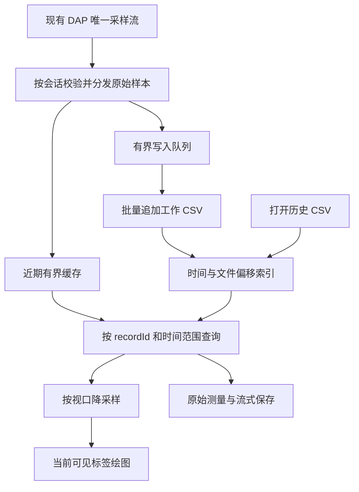

# Timeline 升级计划

- 编写日期：2026-10-03（Asia/Shanghai）
- 状态：核心升级已实现并完成自动化验证；实际 VS Code / 目标板长时间验收待完成。
- 实施更新：2026-10-12（Asia/Shanghai），1.1.7 发布整理；此前各节的测试数字与未发布状态为当时记录，当前结果见第 16.9 节。
- 适用项目：Orbit for VS Code，Windows。
- 范围：A/B 时间游标、统一 CSV 保存与打开、多标签页、持续写盘与长期历史、性能与兼容性。
- 读者：维护 Orbit 的开发者、测试人员，以及验收功能的使用者。

## 1. 目标与设计决定

将 Timeline 从近期实时曲线工具升级为可测量、可保存、可重新打开、可长期回看的调试记录工具，同时保持现有调试控制和实时采样能力。

### 1.1 已确认的需求

| 编号 | 需求 | 本计划的定义 |
|---|---|---|
| R1 | 两条线测量时间 | 两条可拖动的竖向时间游标 A/B；图内标注绝对时间距离 Δt，不在上方展开数值信息；不是左右两套数值 Y 轴。 |
| R2 | 存档和导出合并 | 一个“保存 CSV”功能；CSV 文件前部携带配置，后部携带原始数据。 |
| R3 | 导出选区或全部 | 保存整个记录，或者 A/B 之间的数据；使用相同文件格式和保存入口。 |
| R4 | 随时打开保存的数据 | 打开 CSV 后恢复曲线与视图，不需要连接目标板。 |
| R5 | 理论上无限长保留 | 取消固定十分钟的逻辑保留上限，从开始采样就持续写盘；内存有界，磁盘容量决定实际可保留时长。 |
| R6 | 多个 Timeline 标签 | 标签位于现有 Timeline 面板内部；导入文件、新调试记录分别有自己的数据和视图状态。 |
| R7 | 导入后继续调试 | 导入文件保留在历史标签中；新数据进入新调试会话的实时记录，不能追加到导入文件。 |
| R8 | 解决长时间使用卡顿 | 保留本次已完成的补数与合并优化；长期存储、多标签不能重新引入请求风暴或整段数据复制。 |
| R9 | 左侧变量与配置隔离 | 新调试记录继承保存的调试变量和颜色；CSV 标签使用文件内变量，切回调试页恢复调试变量。查看页的修改不能覆盖调试配置。 |
| R10 | 手动存档与工程目录 | 只有显式保存才生成存档；默认目录为调试工程的 .vscode/timeline，名称为调试开始时间。恢复记录只查找该目录的 CSV，不恢复未保存或异常退出的缓存。 |

文档中的 CSV 是逗号分隔文件；前面讨论中的“CVS”统一写为 CSV。

### 1.2 实施建议与已确认需求的区别

上表是已确认的需求。后文的类名、协议字段、缓存预算、刷盘周期和性能阈值是实施建议，应通过原型和基准验证后冻结；不是当前已存在的产品能力或性能保证。

默认交互：第一版一个当前实时记录加多个历史标签；启动新调试时在 Timeline 内选中新实时记录并开启追踪，不自动切换或聚焦 VS Code 的 Timeline 面板。采集期间可切回历史页，后续样本不会再次切走该页。多个实时视图共享一个记录的能力列为后续扩展。

### 1.3 本轮不做的内容

- 不添加左右双数值 Y 轴；若以后需要，单独定义需求。
- 不修改目标 owner、探针传输方式或调度优先级。
- 不引入第二个采样器或第二条硬件连接。
- 不加入控制参数写入、自动调参、RTOS Trace 或跨记录曲线叠加比较。
- 不把 API 录制服务的内存上限直接去掉，不改变其既有 API 合约。
- 不要求用户保存 ZIP、自定义二进制文件或配置伴随文件；对外的完整记录以单个 CSV 为准。

## 2. 当前实现与性能基线

### 2.1 当前能力和限制

| 位置 | 当前职责 | 升级关联 |
|---|---|---|
| [DataSamplingManager](../src/debug-providers/data-sampling-manager.ts) | 接收采样批次、保存内存数据、提供范围读取 | 增加记录身份；将历史读取交给记录存储层。 |
| [TimelineWebviewProvider](../src/webview/timeline/timeline-provider.ts) | 单一 Timeline Webview、消息与视图状态 | 扩展为多个逻辑标签及按记录路由的范围读取。 |
| [TimelineApp](../src/webview/timeline/app.tsx) | React 状态、Canvas 绘制、拖动、缩放和跟踪 | 增加标签与 A/B；隔离每个标签的缓存和异步任务。 |
| [TimelineRangeController](../src/webview/timeline/timeline-range.ts) | 范围覆盖、补数请求、分辨率与代次检查 | 保留已有保护；增加 recordId/tabId 身份检查。 |
| [timeline-sample-buffer](../src/webview/timeline/timeline-sample-buffer.ts) | 每帧合批和局部数据合并 | 保留局部合并；区分原始数据与显示数据。 |
| [timeline-decimation](../src/webview/timeline/timeline-decimation.ts) | 显示范围降采样 | 继续用于绘图，不用于原始导出和精确测量。 |
| [timeline-history](../src/utils/timeline-history.ts) | 约十分钟的内存历史裁剪 | 改为缓存淘汰；历史是否存在由磁盘记录决定。 |
| [RecordingService](../src/plugin-api/recording-service.ts) | Automation API 的有界录制和分页 | 可参考采样接入能力；保持 API 的预算和兼容性。 |
| [FastSampleSink](../src/plugin-api/fast-sample-sink.ts) | 多个逻辑消费者协调共享高频采样 | 接入记录时审计唯一采样路径，不能重复启动。 |

当前历史窗口为十分钟，裁剪带有约三十秒的滞后，并保留一个前驱点，不能把它描述为严格每到十分钟立即裁剪。API RecordingService 当前最多四份并发录制、每份最多 50,000 帧，实例序列化帧预算为 64 MiB。这些限制不等于未来 Timeline 的磁盘保留限制。

### 2.2 本次已完成的卡顿修复

2026-10-03 的当前工作区已经完成以下修改，尚未提交或推送：

1. 按同一表达式的连续实时采样连接覆盖范围，真实 startsNewSegment 仍保留断段。
2. 对碎片补数合并，并限制最多四条在途范围请求。
3. 切回跟踪时取消旧范围请求；过时回复不能更新历史边界。
4. 小范围重叠补数通过二分定位，只合并相关区间。
5. 范围回复后的继续请求进行合并调度。

会话中完成的验证快照：

| 检查 | 结果 | 证据适用范围 |
|---|---|---|
| Timeline 聚焦测试 | 53 项通过，包含新增七项回归 | 单元测试。 |
| 全量 Vitest | 64 文件通过；911 项通过、1 项跳过 | 当前工作区的自动化结果。 |
| 类型检查、构建、diff 检查 | 通过 | 不等于真实板卡或安装包验收。 |
| 浏览器模拟十分钟历史，三条曲线、每条约 27 万点 | 历史位置切回跟踪：补数请求由 160 条降为 0 条 | 模拟数据和真实浏览器；该场景未记录到超过 50 ms 的长任务，不能据此推算体感改善时长。 |
| Node 离线碎片覆盖场景 | 4 万个覆盖碎片，处理切换补数由约 4,160 ms 降到约 22 ms | 离线算法处理结果，不是浏览器切换耗时。 |
| 浏览器缩放、拖动、跟踪和旧回复晚到 | 通过，未出现页面异常 | 模拟交互；仍需实际 VS Code 验收。 |

实现升级时不得删除这些保护。真实 VS Code 长时间运行后的体感、实际目标读取速率和目标板接受结果分别验证。

## 3. 用户界面与标签行为

### 3.1 标签位置和操作

标签栏位于现有 Timeline 工具栏，按讨论截图中变量输入框右侧的位置布置；使用面板内部标签，不增加多个 VS Code 面板标题。

```text
变量名 [+]    [● 实时·调试3] [底盘测试.csv ×] [调试2 ×] [+]
             保存全部 CSV    保存 A/B 区间
```

现有追踪、时间/div、颜色、显示开关、纵向比例、缩放和清除能力保留。控件作用于当前标签；实时采样与临时磁盘缓存属于当前实时记录，不能因正在查看另一个标签而暂停。

标签显示名称、来源和状态。状态至少区分：实时、已结束、导入中、历史、录制不完整、打开失败。文件重名时可添加序号或路径提示，不使用名称作为内部身份。

右侧标签“+”第一版提供“打开 CSV”。“新建实时视图”列入扩展项，菜单启用后必须明确它是当前实时记录的另一视图，不能被理解为第二个调试连接。

### 3.2 生命周期

| 触发 | 记录与标签行为 | 焦点与数据路由 |
|---|---|---|
| 初次使用、没有活动调试 | 展示空态，支持打开 CSV | 不进行目标读取。 |
| 新调试会话成功开始，且有可采样表达式 | 创建新 recordId 及实时标签，表达式可从实时配置继承 | 在 Timeline 内选中新实时标签并开启追踪；不切换或聚焦 VS Code 的 Timeline 面板，面板隐藏时也保留此选择。 |
| 新会话尚在启动或启动失败 | 展示启动状态；没有有效采样时不伪装为已录制数据 | 不接受上一会话的异步结果。 |
| 打开 CSV | 新建独立历史记录和标签，后台解析并建立索引 | 用户主动打开文件时切到新标签，原实时录制继续。 |
| 后台收到实时样本 | 更新当前会话的实时记录并写盘 | 仅可见实时标签需要逐帧更新；历史标签不变化。 |
| 同一会话暂停、继续、复位/Restart | 保持记录身份，根据实际断段创建 segment | 不把暂停区间绘成连续插值，也不因每次复位创建新标签。 |
| 调试结束或 owner 丢失 | 停止接收该会话数据，排空或标明未完成的写入，转为已结束/不完整标签 | 该记录仍可查看、保存；新会话使用新身份。 |
| 再次开始调试 | 创建新实时记录，上一记录保留 | 不追加旧记录，不修改导入 CSV。 |
| 关闭历史/已结束标签 | 取消其查询任务并释放显示缓存 | 不删除手动保存的原 CSV；关闭页签清理该页临时缓存，未保存数据不进入恢复列表。 |
| 关闭正在采集的实时标签 | 第一版不允许直接关闭，显示原因 | 不能因关闭页面而终止目标调试或静默停止录制。 |

第一版一个记录对应一个标签。后续多个实时视图可共享 recordId，但各有 tabId 和视图状态；采样表达式由统一协调器汇总。

### 3.3 标签状态隔离

每个标签独立保存：曲线显示列表、颜色、纵向比例与中心、自动比例开关、时间/div、视口位置、跟踪开关、A/B 游标、加载分辨率和请求代次。

配置分两层：工作区保存“调试默认配置”，记录保存自己的“查看配置”。新调试会话继承调试默认配置；打开 CSV 时，整个左侧列表换成文件中的变量和颜色。切回调试标签时，整个列表恢复为该调试记录的变量。只有实时/调试配置页的修改可以更新下一次调试使用的默认配置；历史页的颜色、比例和显示勾选只影响该历史页及其重新保存的 CSV。历史页不提供向目标添加或删除采样变量的操作。

“追踪”含义统一为跟随该记录的最新边界。实时页随新数据前进；历史页定位到文件末尾，不触发硬件采样。

点击变量色块展开页面内调色盘，底色、文字和输入框跟随 VS Code 主题；支持拖动饱和度/明度、调整色相、输入 RGB 或十六进制颜色，下方提供常用色块。内部点击、拖动和滚动保持打开，点击外部、Escape 或关闭按钮退出；改色只刷新条目，不重新激活整个页面。历史页改色只影响该记录。新变量从当前已有颜色（含自定义和隐藏曲线）中选择感知色差尽量大的颜色；常用颜色接近用尽时扩展候选颜色，不修改已有变量配色。恢复配置时保留显式保存的颜色，并为未指定颜色的条目避开这些颜色。

滚轮以鼠标所在时间点为缩放基准；上方加减号及时间/div 输入以图表中心时间为基准。缩放自动取消追踪，并保持基准时间在图内的横向位置。记录边缘允许出现空白，避免缩放时视口被拉回文件末尾；后续拖动不会因空白边缘突然跳位。右键点击图表空白区域开启追踪，右键点击 A/B 游标仍只删除该游标。

“清除”不能继续默认删除全局数据。建议实时页执行“开始新的记录”：结束旧记录并在本窗口保留历史标签，是否存档由用户显式保存决定，在同一调试会话下创建新的录制记录，不停止目标；历史页清除视图只重置视图，不删除源 CSV。此交互属于实施建议，应在界面中明确命名，避免用户把视图清理误认为文件删除。

### 3.4 会话恢复

workspaceState 仅保留调试默认变量、颜色与轻量调试配置，不保存曲线、记录路径或待恢复标签。重载 VS Code 后不自动恢复未保存的历史记录。用户点击“恢复记录”时枚举已打开工程的 .vscode/timeline 下直接存放的 CSV，选择后打开独立历史页；“打开 CSV”仍可手动选择其他目录的文件。

## 4. A/B 时间游标与测量

### 4.1 交互

- 左键单击曲线区域空白处依次放置 A/B，最多两个；右键点击已有游标删除该游标，不设置添加/清除游标按钮或常驻操作提示。
- 游标绑定记录时间，缩放和移动视口不会改变其时间值。
- 拖动游标优先于画布平移；画布其他区域仍可平移。
- 拖动 A/B 时，灰色鼠标虚线、悬浮数值与提示框同步跟随鼠标。
- A/B 可交换顺序；选区始终取 min(tA,tB) 到 max(tA,tB)。
- 游标超出视口仍保留原时间，不自动挪动到最新时间；通过移动视口查看，不设置上方定位按钮。
- 切换标签保留各自游标；保存文件恢复其位置。

### 4.2 第一版测量内容

仅在图内 A/B 之间显示横向距离线和 Δt=|tB-tA|，单位随量级使用 ms/s。上方不显示 tA、tB、曲线 A/B 值、命中点时间或值差，也不显示操作提示。游标移动仍保留原始时间精度，选区保存按两者的真实时间范围执行。

鼠标悬浮值只显示数值，不附加“显示点”；断段、缺测、范围外或没有样本时数值留空，不显示“无数据”，不补零或跨段插值。原始点近邻测量接口保留给后续明确启用的测量功能，当前前端不发起 A/B 原始值查询。

所有标签均显示变量输入框。调试页按既有路径添加采样表达式；历史页仅添加或重新启用当前记录已有的通道，未记录的变量不触发目标读取，且不改变调试默认变量、颜色或采样注册。

时间单位自动在 ms/s 等量级间显示，但文件保存原始精度。现有采样时间戳表示软件采样时间口径，不承诺等同 MCU 内部硬件事件时间或逻辑分析仪精度。

### 4.3 后续测量扩展

可增加区间最小/最大/平均值、峰峰值及频率估算。频率 1/|Δt| 仅在用户选中了对应周期时有意义，不能把任意两点的倒数标为信号实测频率。区间统计由后台原始数据计算，并显示缺测或不完整状态。

## 5. 统一保存与打开 CSV

### 5.1 一个保存入口

“保存 CSV”对当前记录生效，保存窗口选择：

1. 范围：全部或 A/B 区间；无有效 A/B 时禁用区间保存。
2. 曲线：默认当前显示曲线，可选择其他已有数据曲线；明确被隐藏不等于没采样。
3. 配置：默认包含 Orbit 配置；“仅数据 CSV”为兼容选项，属于同一个保存流程。
4. 目标文件路径。

全部与区间导出使用同一实现。第一版不另设“存档格式”，不要求伴随配置文件。导入的源文件默认只读；调整视图后保存为新文件，覆盖已有文件必须由用户明确选择。

### 5.2 格式建议：Orbit Timeline CSV v1

编码 UTF-8，规范输出使用 CRLF，十进制小数点固定为点号；读取兼容 LF 与 UTF-8 BOM。CSV 配置行使用 # 前缀，正文使用固定四列的长表结构。

```csv
# orbit-timeline-version=1
# meta={"recordId":"example-record","name":"底盘测试","timeUnit":"ms","timeOriginUtc":"2026-10-03T03:00:00.000Z","source":"debug","complete":true,"exportRange":{"startMs":100,"endMs":500}}
# channels=[{"id":0,"expression":"power_meter_actual_power","color":"#4EC9B0","enabled":true,"yPerDiv":50,"yCenter":0,"yAutoScale":false}]
# view={"timePerDiv":1000,"autoFollow":false,"viewportEndMs":500,"cursorA_ms":100,"cursorB_ms":500,"entries":[{"expression":"power_meter_actual_power","color":"#4EC9B0","enabled":true,"yPerDiv":50,"yCenter":0,"yAutoScale":false}]}
time_ms,channel_id,value,segment_id
100.125,0,42.153,1
102.362,0,42.681,1
104.641,0,43.012,1
# orbit.end={"kind":"export","rows":3,"fileFinalized":true,"recordComplete":true,"rangeComplete":true}
```

配置头职责：

| 配置 | 内容和约束 |
|---|---|
| 版本标记 | 首个有效配置行识别格式；不支持的未来版本给出明确错误，不能错误按 v1 恢复。 |
| meta | 记录名称、来源、原始记录身份、时间原点、完整性、导出范围；固件/设备/采样配置可作为可选字段。 |
| channels | 稳定 channel_id 到表达式、显示设置和可选单位的映射；ID 在同一记录中不复用。 |
| view | 时间比例、视口、跟踪及 A/B；导入历史标签默认不自动启动任何采样。 |

正文语义：

- time_ms 为相对原记录起点的时间，保留输入采样时间戳精度；不按保存时刻重新计时。
- channel_id 对应配置映射；长表允许各曲线有不同采样时间，无需对齐或填充上一帧值。
- value 保存原始有限数值，不能用经过格式化或四舍五入的 display 字符串替代。
- segment_id 按通道区分连续段；通道和段的组合确定连接关系。多个通道的同号段不表示共享连续性。
- 缺测没有伪造样本；发生丢点或录制异常时另存完整性说明，不能把零值当缺测。
- 导出原始数据，不导出为绘图而降采样的点。

原始记录的 recordId 保存在文件中用于来源追踪。导入时创建新的本地运行身份，另记 originalRecordId；重复打开同一文件也不会与活动调试记录串页。

### 5.3 配置变化与持续录制

持续录制从开始创建工作 CSV，写入初始配置头后只追加数据。运行期间视图配置变更保存在会话状态中，不因移动游标反复重写大文件。

通道在运行期间可以增加或变更，不能因为文件头的初始 channels 不包含它而无法恢复。建议工作 CSV 使用明确的追加配置事件行，例如：

```text
# orbit.channel={"id":1,"expression":"chassis.chassis_motor[0].target_velocity","color":"#569CD6"}
```

对应通道的定义必须先于该通道首次数据出现。新表达式使用新 ID；删除通道仅停止其新样本，旧定义和历史数据保留。颜色和比例的最终状态在正式保存时统一写入完整 channels/view 头；普通数据读取器跳过 # 行。缺测、异常结束等事件也采用有版本定义的配置事件，具体键名在格式冻结阶段统一，不允许随意添加无法解析的注释协议。

正式保存按保存快照重新输出最新配置头和原始正文，通道定义汇总到文件头。内部工作文件不是要求用户一起分享的第二种存档格式；正式对外文件仍为单个 CSV。

### 5.4 CSV 兼容性

配置头是 Orbit 约定，不是通用 CSV 读取器一定识别的规则。参考 RFC 4180 的列名和数据记录约定；包含配置头的文件需要先跳过配置行。

例如 pandas 可以使用以下形式读取数值正文：

```python
import pandas as pd
frame = pd.read_csv("timeline.csv", comment="#")
```

“仅数据 CSV”不输出配置行，可供只接受普通表格的工具读取；其曲线映射可以使用表达式列替代 channel_id，具体列模式在格式阶段冻结，并在保存界面说明无法完整恢复视图。

第一版完整恢复针对 Orbit v1 文件。任意外部 CSV 的时间列/单位/变量映射导入属于扩展项；不能把“打开 CSV”宣传为支持所有第三方 CSV。

### 5.5 保存正在采集的记录

点击保存时冻结 recordId、曲线选择、配置、范围和采样序号上界。保存任务只导出该快照之前的数据，后续实时采样继续写入当前工作文件，不加入这次导出。

“全部”截至点击时的已接收样本；后台等待这些样本写入完成，必要时合并有界缓存中的尾部，然后输出。A/B 导出使用闭区间；不额外导出仅为绘图连接而读取的边界前驱点。保留原时间原点、原时间偏移和真实段编号，不伪造起点为零的新测量记录。

导出采用流式读取与写入，不能拼接整个 CSV 到大字符串。写入同目录临时文件，成功后替换/生成目标文件，失败时原文件保留。提供进度与取消；取消只取消保存任务，不影响采样或源记录。文件元信息区分“原记录是否完整”和“选区是否完整”。

### 5.6 打开文件

按文件头识别和验证版本、通道、时间单位、数值及完整性；创建历史标签后，后台扫描并建立索引。允许显示初始可用范围和解析进度，不能在 Webview 主线程解析整份大文件。

索引存在且与文件匹配时复用；不存在或失效时重建。非法头、未知通道、非法数值或截断尾部给出行号/字节位置与可恢复范围，不执行文件中的表达式，也不因为导入而启动调试。

规范输出在记录时间轴上有序；解析工作文件保持通道自身时间顺序。外部异常乱序或重复点采用明确的拒绝/修复策略并报告，不悄悄重排或合并，具体策略在格式测试阶段冻结。

## 6. 长时间存储与按需读取

### 6.1 “无限长”的实际定义

取消固定时长删除原始记录的行为。从第一个样本开始追加写入临时缓存，持续到用户停止、调试结束、写盘失败或达到存储限制。调试结束后仍可在本窗口查看、保存；关闭历史标签或 Extension Host 后清理缓存。工程存档只在用户点击保存并确认路径后生成。不是无限内存或磁盘保证，也不允许磁盘失败后继续显示“完整记录”。

十分钟以后只淘汰内存中的旧缓存，磁盘数据仍然可查。近期跟踪直接读内存，回看更早的数据通过索引读磁盘；不强制每一个实时显示点都先写盘再读回。

### 6.2 架构



建议由 Extension Host 的记录管理层协调后台文件服务。CSV 编码、扫描、索引、区间解析和长区间统计使用后台工作线程或等效可取消后台任务；不能用同步文件 I/O 阻塞采样接收或 Webview。

### 6.3 索引设计

索引保存记录身份、文件标识、版本、数据区起点、通道信息，以及每个块的时间范围、字节起止位置、行数和断段摘要。

索引按块建立，不能给每个样本创建一个常驻 JavaScript 对象。长时间记录的索引也应分页或保存在可重建的磁盘缓存中，内存只保留粗粒度入口和近期块，避免索引本身随时长无界增长。

索引缓存由 Orbit 管理；用户分享正式 CSV 时不需要发送索引。识别文件变更后重建或增量更新，不能用过时偏移读取被重写的文件。首次打开大文件需要扫描，不能宣称完全无解析成本。

内部写盘分块用于当前窗口的追加、索引和历史查询；不作为异常退出恢复入口。第一版不要求用户维护多个分段 CSV；如果后续因文件系统或超大文件限制需要物理分片，必须保持单文件保存接口，另行验证汇出与打开性能。

### 6.4 读写与内存边界

建议初始预算，均为待基准验证的参数，不替换既有 API RecordingService 预算：

| 资源 | 初始建议 | 验证重点 |
|---|---|---|
| Timeline 近期原始缓存 | 全实例约 64 MiB 估算预算，外加可配置近期时间窗 | 多曲线和多标签不能各自无限复制原始数据；序列化大小不等于实际 heap。 |
| 待写入队列 | 全实例约 8 MiB | 队列饱和明确报错，不静默丢点。 |
| 历史块缓存 | 全实例约 32 MiB，按使用情况淘汰 | 多文件打开后仍有界。 |
| 文件批量写入 | 约 100–250 ms 合批，兼顾大小上限 | 不是逐点同步写，也不无界等候。 |
| 索引块粒度 | 约 1 秒或数千行，结合字节量控制 | 高频率下有可控的范围定位和解析成本。 |
| 可见曲线显示点 | 随绘图区宽度控制，约每像素最多数个包络点 | 放大不丢峰值，缩小不发送几百万个点。 |
| 范围在途请求 | 每标签最多四条，并有全实例队列上限 | 标签切换取消旧任务；并发磁盘读有界。 |

记录与标签数量增加时，全部实例预算统一管理；不能把上述预算乘以打开的标签数。隐藏标签不持续绘图，不持续维护整份前端样本缓存，但其轻量视图状态保留。

### 6.5 显示数据与原始数据

同一个查询接口分别支持 display 和 raw 模式。display 只返回当前视口与有限预取范围的降采样点；raw 流式返回真实点供保存和统计。A/B 附近取值只需小范围原始查询，不必拉整份记录。

降采样保留每个桶的首末值与极值，保留真实断段。跨越数小时或数天的全景显示需要分层摘要；摘要可作为可重建索引的一部分，详细算法在性能阶段验证，不能每次全景缩放都扫描全部历史 CSV。

原始数据在热缓存与已写盘区域交界处按采样身份/字节边界去重，避免同时从两处读取而重复保存。

## 7. 数据身份、状态和消息协议

### 7.1 模型建议

- TimelineRecord：recordId、来源、调试 session 身份、工作/源文件、通道、时间原点、起止范围、接收/写入上界、完整性与状态。
- TimelineTab：tabId、recordId、名称和独立视图状态。
- TimelineRecordStore：接收原始批次、持久化、查询原始/显示数据、保存快照、打开、恢复与释放。
- TimelineFileIndex：查询索引与摘要；可重建，不能替代 CSV 原始数据。

这些是建议的职责划分，不是当前已存在的类。核心要求是“数据属于记录，显示属于标签”，不能继续以一个全局表达式 Map 代表所有文件和会话。

### 7.2 身份检查

活动数据接收同时校验精确的 vscode.DebugSession 身份与会话代次。范围查询和回复至少携带 recordId、tabId、requestId、generation、resolutionKey；后台保存任务携带 recordId、taskId 和快照上界。

先校验身份及代次，再更新历史范围、写入缓存或显示数据。标签关闭、切换数据源、分辨率变化、调试会话被替换后，过时完成结果必须丢弃。已经接受但尚未逐帧发布的批次也要带来源与代次，不能只保护网络回复。

实时样本属于记录，不属于当前显示标签。切换到历史标签不会把新的实时数据送给历史页，也不会停止后台写盘。

### 7.3 接入现有采样和 API

保留 dataSamplingStart / ozoneDataSamples 现有采样链路；存储接收原始批次，不为写盘再读一次目标。实施前审计 DataSamplingManager、FastSampleSink 和 RecordingService 的协调方式，确认只有一个选定 owner 和一个会话级连续采样入口。

API RecordingService 的帧对齐、分页、截断事件与预算继续遵守现有合约；Timeline CSV 不应直接复用其中沿用上一值的帧作为原始采样点。若新增历史查询 API，另行定义能力和版本，不在本升级中暗改现有返回结构。

### 7.4 兼容性要求

- 维持 SessionTargetSelector 的唯一物理 owner，以及 control > watch > timeline > background。
- 维持活动 DAP 会话的路由；不能绕过 DAP 连接 Extension Host 后端。
- 不因长期录制增加 getTargetState 逐点查询，也不暂停 Watch、变量读取、写入或调试控制来换取吞吐。
- 沿用表达式归一化、真实断段、会话 fence 和旧状态迁移。旧 ozoneTimelineState 迁移为默认实时视图模板，不直接当成历史文件数据。
- 清理历史文件服务不会重启或释放目标 owner；记录结束和调试结束是不同职责。

## 8. 异常、恢复和保存一致性

### 8.1 写盘失败或磁盘不足

写盘失败、文件不可访问、队列饱和时，立刻标记录制不完整并展示原因、最后成功写入时间和未保存范围。停止这份记录的持久化，不无限堆积内存，也不静默删除旧磁盘数据。

目标调试不因磁盘异常自动 halt、reset 或断开。实时可视化可以继续使用有界缓存，但必须明确其后续数据未被完整存档。恢复录制作为显式新记录操作，不伪装旧 CSV 中的空缺已恢复。

### 8.2 写入上界与系统崩溃

区分已接收、已写入操作系统缓存、已完成持久化检查点三个上界；不能把异步 write 完成自动称为断电安全。检查点周期与 fsync 策略需要原型验证，常规追加不能逐点 fsync。

意外关闭后不恢复未保存的采样缓存。缓存按 Extension Host 进程隔离，正常关闭时清理；下次启动只清理所属进程已退出的残留，不影响其他仍运行的 VS Code 窗口。用户手动保存的 CSV 保留在原位置；显式打开损坏 CSV 时仍可按完整有效行报告可读前缀，不能把它当作完整记录。

### 8.3 大文件、取消和文件变化

导入、索引、统计、保存都显示进度，可取消并释放资源。关闭某个标签只取消该标签的任务，不能取消其他标签或实时记录。

验证大于 2 GiB 文件的偏移、读写和索引，不能依赖 32 位偏移或一次性 Buffer。可通过稀疏文件验证偏移正确性，再用真实内容验证解析吞吐；两者的验收意义分别记录。

发现源文件被外部修改时，暂停使用旧索引并提示重新载入；不能在历史视图中混合修改前后的数据。

### 8.4 配置和数据校验

配置 JSON 当作数据处理，限定大小、类型和版本，不执行代码。完整性字段、单位和通道映射必须校验。缺失视图字段使用可解释的默认值；必要的数据字段缺失则报告格式错误。表达式仅作为历史标签名称和来源信息，打开文件本身不把它加入当前实时采样。

## 9. 实施阶段与交付门槛

| 阶段 | 交付 | 完成门槛 |
|---|---|---|
| P0：性能基线 | 保留本次卡顿修复和回归用例 | 当前代码检查通过；补齐实际 VS Code 验收，不把离线结果当真机结论。 |
| P1：记录模型与标签基础 | 独立 recordId/tabId、来源与状态、内部标签栏、会话生命周期和视图隔离 | 导入占位记录与新实时会话不串页；旧回复丢弃；单 owner 不变。 |
| P2：格式和存储原型 | CSV v1 编解码、追加配置事件、批量写盘、索引、热缓存与范围查询 | 原始点回读一致；追加/取消/截断恢复有效；接口和格式冻结。 |
| P3：用户功能 | A/B、Δt、原始点取值、统一保存全部/选区、打开历史 CSV | 选区闭区间结果一致；视图配置可往返；后台采集不因历史页而停止。 |
| P4：长期保留与大范围性能 | 取消磁盘历史时长上限、全局缓存预算、分层摘要、离线重开和异常提示 | 数小时/大文件数据验证内存有界；历史查询和跟踪无请求风暴。 |
| P5：发布验收 | 全量回归、实际 VS Code、授权真机对照、按需 VSIX 包装、用户说明 | 各层结果分别记录；用户确认后再按仓库规则写修复历史。 |

P2 可先通过独立存储接口原型验证；P3 使用该接口，不直接操作全局数组。阶段不是固定工期承诺。每阶段提交可审查的最小改动；格式或协议有变动时及时更新本计划。

后续扩展：多个共享实时视图、A/B 区间统计、任意外部 CSV 映射导入、跨记录叠加比较、更多测量工具。若 CSV 在实际超长记录中成为已测量瓶颈，再单独评估二进制内部缓存；对外 CSV 接口仍保留。

## 10. 验收矩阵

| 编号 | 场景 | 必须得到的结果 |
|---|---|---|
| A01 | 连续采样十分钟，再历史回看 → 跟踪 | 批次间隔不制造补数；每标签在途请求不超过四条；旧历史回复不改变当前视图。 |
| A02 | 加载历史文件后开始调试 | 历史数据不变化；新会话有独立记录；历史页可保持焦点。 |
| A03 | 打开多个文件、相同文件重复打开 | 身份和视图隔离；同名不串页；全实例缓存有界。 |
| A04 | 新会话、暂停、继续、复位、结束与 owner 丢失 | 记录和段生命周期符合定义；过期会话数据被丢弃。 |
| A05 | A/B 拖动、交叉、缩放、移出视口 | 时间位置保持；Δt 符号和选区一致；拖动不误触平移。 |
| A06 | 游标落在真实断段或缺测范围 | 数值留空；不跨段插值或以零代替。 |
| A07 | 保存全部、A/B 区间和部分曲线 | 与原始点逐项一致，不含额外前驱或显示降采样；元信息和映射一致。 |
| A08 | 实时采样过程中保存 | 固定快照上界；保存任务可结束；后续采样与文件追加继续。 |
| A09 | 保存后重新打开 | 数值、原始精度、时间原点、段与视图配置往返一致；不连接目标。 |
| A10 | 中途增删表达式或改颜色/比例 | 新通道先定义；旧历史保留；正式文件头汇总最新显示配置。 |
| A11 | 隐藏 Timeline 面板/标签后恢复 | 原始记录连续写盘；恢复只加载需要的范围，不堆积无限前端批次。 |
| A12 | 磁盘满、文件锁定、写入队列饱和 | 明确不完整状态和最后写入范围；内存有界；目标控制不被自动改变。 |
| A13 | 进程异常结束、未保存数据与损坏 CSV | 异常缓存不出现在恢复列表，启动清理死进程残留；手动 CSV 保留，显式打开截断文件时报告不完整。 |
| A14 | 取消导入/保存、关闭历史标签 | 对应任务释放；其他标签和目标采样继续；原文件不损坏。 |
| A15 | 无索引、旧索引、文件被外部修改 | 正确重建/提示；不使用错误字节偏移。 |
| A16 | 大于 2 GiB CSV、数小时和全景视图 | 偏移正确；按块读取；索引与显示缓存有界；全景采用摘要。 |
| A17 | 普通工具读取和仅数据模式 | 有配置 CSV 通过跳过配置行读取；仅数据模式无特殊配置头。 |
| A18 | Watch/RTT/调试控制与录制同时工作 | 单 owner、优先级、DAP 兼容性不回退；性能比较保持相同 workload。 |

## 11. 测试与性能评估方法

### 11.1 自动化

- 格式测试：UTF-8/BOM、LF/CRLF、精度、配置缺省、未知版本、追加通道、缺测、断段、非法行和截断尾部。
- 存储测试：真实临时文件、追加与范围查询、索引失效、边界去重、快照保存、任务取消与写盘错误注入。
- 路由测试：标签身份、会话身份、代次、分辨率、晚到回复与待绘制批次隔离。
- UI 测试：真实浏览器或 VS Code Webview 的 A/B、标签、缩放、拖动、跟踪、打开和保存流程。
- 长程测试：使用可复现的模拟数据生成数小时记录；增加曲线数和标签数，检查 heap、RSS、缓存、队列、磁盘增长与原始行数。

继续运行现有 Timeline 相关测试，并按变更范围检查 DAP 实时变量、NativeScheduler 和录制服务；全量 Vitest、typecheck、build、git diff --check 作为发布前基本检查。

### 11.2 指标和待验证目标

记录目标读取完成率、采样批次/点数、接收/写入差额、查询 P50/P95、切换耗时、浏览器长任务、可见点数、内存、文件大小及队列峰值。不能把 UI 帧率、读取 Hz 或配置间隔当成彼此的实测结果。

建议原型性能目标：常规缓存命中切回跟踪 P95 小于 100 ms；当前视口历史查询 P95 小于 200 ms；目标机器上的常规交互不因本功能新增重复的超过 50 ms 主线程任务。首次大文件建索引和完整保存属于有进度后台任务，不套用上述交互阈值。这些目标需明确测试机器、数据量、磁盘和曲线数后再冻结。

热缓存、队列、块缓存和前端点数应由预算控制；总 RSS 可受运行时和 OS 文件缓存影响，验收同时看组成、趋势和稳定区间，不能只用一个固定 RSS 数字判断。长期原始数据行数和通道/段数要能与采样输入核对。

### 11.3 真实 VS Code 与目标板

实际 VS Code 完成多标签、历史文件、十分钟以上采样和回看跟踪验收。真实板卡测试另需用户授权，保持固件、探针 transport、唯一 owner、Watch/Timeline 表达式与 RTT 设置一致，分别报告采样影响和 UI 影响。

本计划文档的编写不授权 halt/run/reset/Flash 或其他目标状态修改。单元测试、浏览器模拟、构建、安装包验证和板卡接受结果分层列出。

## 12. 回退与发布边界

阶段性引入新存储层，保留可测试的旧短时内存路径作为开发期间的受控回退。回退只涉及 Timeline 数据功能，不能换 owner 或创建额外后端；需要报告长程录制不可用，不能悄悄恢复十分钟删除并继续显示无限保留。

新格式使用显式版本；更新应继续读取已发布 v1 文件。若读写协议尚未冻结，开发产物标记为预览，避免将临时格式当正式档案。

不手动编辑 dist；通过构建生成。Git 提交信息使用中文，明确本地提交与远程推送状态。现有无关工作区改动保留。只有用户明确确认修复后，才更新 docs/bug-fix-log.md。

## 13. 实施前需冻结的具体参数

以下事项不阻止编写计划或制作原型，但在相应阶段发布前必须定稿：

1. CSV 配置事件、完整性/异常信息和仅数据模式的精确 schema。
2. 游标近邻取值、断段空隙识别与吸附阈值。
3. 全实例内存和写入预算、批量刷新、持久化检查点周期。
4. 保存目录与临时缓存策略已按 R10 确认：工程 .vscode/timeline 仅放手动存档；关闭历史标签或宿主后丢弃未保存数据，异常缓存不恢复，不删除用户 CSV。
5. 全景摘要、索引文件分页和大文件偏移验证方案。
6. 活动页“清除/新记录”、焦点提示、重复打开和恢复标签的最终交互。
7. 多个实时视图的启用阶段与统一表达式协调方案。
8. 测试机器和性能验收阈值。

## 14. 完成标准

当 R1–R9 有对应实现和验收证据，单 CSV 可保存/重开全部或选区，历史与实时标签隔离，长期记录不受固定十分钟删除限制，内存及请求量有界，且现有调试和采样兼容性通过分层验证时，升级完成。

当前状态：P0 的补数优化、P1 的记录与标签隔离、P2 的 CSV 存储/索引、P3 的游标与保存打开、P4 的有界缓存和长期查询已接入；P5 的自动化与浏览器验证已完成，实际 VS Code、目标板长时间验收与发布包验证仍待完成。实施证据与参数见第 16 节。

## 15. 实现契约补充

本节补齐独立读者检查发现的边界。以下为可执行的设计建议；实现时遵循这些规则，参数仍按第 13 节通过测试冻结。

### 15.1 工作文件、正式文件与事件归并

- 工作 CSV 也可由“打开 CSV”恢复；读取器从初始配置头开始，按文件顺序应用已定义的追加事件，再生成最终记录状态。
- 工作文件正常结束使用有版本定义的结束事件，包含结束原因、最后接收/写入/检查点上界及完整性摘要。正式保存也在正文末尾输出 export 结束标记和数据行数；配置示例展示了该标记。Orbit v1 文件缺少结束标记或行数不匹配时按异常结束处理，不能因为头部有 complete=true 就视为完整。
- 文件输出已结束（fileFinalized）与原记录/选区数据完整是不同状态：不完整记录也能正常保存为带结束标记的文件。读取器分别报告，不能把正常导出误认为没有丢点。
- 正式保存的头部包含保存快照的最终视图和完整通道定义；不再要求读取器通过通道更新事件才能获得通道名称。
- 丢点、缺测范围、异常结束等影响数据解释的证据不能在汇总头部时丢弃。摘要写入 meta，详细缺口可作为 # orbit.gap 事件按时间保留在正文中；大记录的缺口列表不能全部塞入无界配置头。
- 每个缺口事件指定受影响的通道 ID、时间范围、原因和已知/未知损失数量。未知损失不填写推测的点数。
- 支持哪些追加事件、各自的 schema 及覆盖顺序是 v1 格式的一部分；未知关键事件报错，不能忽略后仍声称完整恢复。
- 元信息至少分别表达原记录完整性、导出区间完整性及所选曲线完整性。仅数据模式保留现有样本，不补零或沿用值；保存界面提示其不携带完整性和视图元信息。

### 15.2 时间轴、断段与游标判定

- 当前采样的主机时间基准在同一调试会话内持续使用。正常复位不把 time_ms 重置为零，只开启新的采样段；新会话使用新的记录和原点。
- 规范写入不得悄悄改写原始时间来消除倒退。若收到不可解释的时间倒退，结束并标记当前记录异常，由明确的新记录接续；保留原因。外部文件的异常时间轴按打开策略报错或显式修复。
- 每个通道、每个段记录第一和最后有效样本时间；相邻两个不同段之间的开区间，以及显式 gap 事件覆盖的空隙，判定为无数据。
- 段内普通采样间隔允许最近点取值；先判断游标是否在有效段范围内，再判断最近点距离是否在允许阈值内，最后报告真实命中点时间。不能先吸附后跨过断段。
- 多通道独立判断可用性；同一个 A 时间点可能只有部分曲线有数据。单点段不能假装覆盖前后连续时间。
- 阈值由该通道实际样本间隔推导，存储格式提供必要信息或允许后台计算；默认倍数和单点容差在 P2/P3 冻结。没有可用间隔依据时显示不可用，不以屏幕像素或绘制周期猜测测量精度。

### 15.3 通道增删、隐藏与空采样集合

- 通道 ID 是记录内一次采样注册的身份。删除后再次添加同一表达式使用新 ID，旧通道和历史保留；界面可用后缀或来源提示区分，不能因名称相同覆盖历史。
- 显示开关只影响曲线是否绘制，不撤销该记录的采样注册。删除动作停止对应注册的新样本，历史仍可在曲线选择/保存窗口选取。
- 删除最后一条采样表达式时，当前记录进入“等待表达式”状态，保留文件、标签和视图；不生成伪造样本。不存在其他逻辑消费者时允许协调器停止连续采样入口。
- 在同一会话内重新添加表达式后，继续当前记录，使用新通道 ID 和新段；等待期间的空隙不得连线。新调试会话仍必须新建记录。
- 用户明确“开始新的记录”时，结束旧记录并创建新 recordId；这与隐藏曲线、等待表达式及新建实时视图分别处理。

### 15.4 保存快照与失败终止

- 快照具有确定的采样序号上界；等待写入只等待该上界，不等待未来采样。
- 等待具有取消和超时条件；发生明确写盘错误、源记录被释放或无法达到该上界时，立即退出等待并报告保存失败/可恢复状态，不能无限悬挂。
- 可恢复数据范围为已写盘的完整有效行与仍在有界缓存中的原始点的并集。未写盘且已被淘汰的点不可恢复，必须标记对应缺口。
- 默认完整保存无法满足时，不能无提示输出成功。允许在同一个保存流程中明确选择“保存可恢复数据”，生成标记为不完整的 CSV。
- 原记录不完整不必然代表某个选区不完整。选区完整性取决于所选通道与冻结区间是否相交于已知丢点/截断范围，以及是否存在无法排除的未知损失；真实暂停断段本身不等于文件损坏或丢点。
- 如果无法定位损失范围，只能保守标记无法确认完整。文件、进度和结果提示采用相同判定，不互相矛盾。

### 15.5 录制消费者与 Webview 生命周期

- 录制消费者属于记录管理层，采样接收和写盘不依赖可见的 TimelineApp 或 Webview 消息处理器。
- 隐藏某个标签、隐藏整个面板、销毁后重建 Webview 三种情况都不能自动移除仍有效的录制消费者；只停止显示消息、绘图和视口查询。重建后从记录管理层恢复轻量状态与所需范围。
- 调试会话结束、记录明确停止或被替换后，释放该记录的采样注册。只有所有逻辑消费者都不需要连续采样时，协调器才停止会话级采样入口。
- 写盘失败撤销持久化职责，但可视化是否继续取样按第 8.1 节的有界模式处理，并由管理层保留一个明确的消费者；不能创建备用目标连接。
- Extension Host 进程结束不属于“隐藏面板”；按 R10 丢弃未保存缓存，不恢复曲线或承诺退出后继续录制。
- 将 A11 拆为隐藏标签、隐藏面板、Webview 重建三个实际验收子场景。逐一比较输入采样点数、磁盘有效行数、缺口事件和最后写入上界，证明连续记录，而不仅检查恢复后曲线有内容。


## 16. 本轮实施结果（2026-10-04）

### 16.1 已接入的功能

- 左侧变量列表、颜色与纵向配置随标签切换；CSV 查看配置与调试默认配置隔离。
- 新调试会话创建自己的实时记录；历史页正在被查看时，后台实时记录继续接收数据并写盘。
- 调试结束保留历史记录；实时页的“新记录”结束当前记录并开始新的记录，不控制目标运行状态。
- 曲线区域左键单击空白处依次放置 A/B（最多两个），左键拖动已有游标调整位置，右键点击已有游标删除；移除添加/清除游标按钮。空白处拖动仍用于浏览历史，不会新增游标。仅在图内标注绝对时间距离 Δt，上方不展开游标或变量测量信息；悬浮值不附加说明，缺测时留空。
- 保存全部/选区使用同一 Orbit CSV v1；配置在注释头，原始点在四列表体；保存点击时冻结快照，之后的采样继续。
- 打开 CSV 创建独立历史标签；工作区重载只继承调试默认变量和颜色，不恢复未保存曲线。调试结束的历史标签在当前窗口仍可查看和手动保存。
- 开始即写盘；十分钟成为可选缓存窗口的参考，不再是历史保留上限。当前实现按字节预算淘汰近期缓存，历史仍在 CSV 中。
- 磁盘错误、尾行不完整、结束标记缺失会显示不完整状态；可保存仍可读取的数据，持久化缺口会写入事件并断段。

### 16.2 当前实现参数与边界

| 项目 | 当前实现 |
|---|---|
| 手动存档 | 调试工程 .vscode/timeline；默认名称 YYYY-MM-DD_HH-mm-ss-SSS.csv，使用本次调试开始的本地时间；同一次调试新记录沿用开始时间。多根工作区优先选所属调试工程，无工程时保存对话框回落到用户主目录。 |
| 临时缓存 | 系统临时目录 / orbit-timeline-cache / 宿主PID-UUID / recordId / record.csv；仅用于当前窗口范围查询。关闭历史页或宿主时删除；启动清理死进程残留。 |
| 对外文件 | 单个 UTF-8 CSV，CRLF；打开兼容 LF/BOM；附带版本、meta、channels、view 和结束标记。view.timePerDiv 的单位是 ms。 |
| 原始行 | time_ms,channel_id,value,segment_id；原始时间偏移和有限数值精度保留。 |
| 写盘触发 | 200 ms 定时或至少 2048 待写点；单块最多 2048 点。 |
| 检查点 | 写入阶段约 1 s 执行 fsync；正常结束再次同步并更新 checkpointRows。 |
| 全实例缓存预算 | 近期原始点按 128 字节/点估计限 64 MiB；待写队列 8 MiB；历史数据块 28 MiB + 索引页 4 MiB。估算预算不等于进程 RSS。 |
| 索引/摘要 | 固定 56 字节索引项、每页 64 项；16 个块合成上一级摘要，当前 9 层；索引与摘要均可从 CSV 重建。 |
| 文件任务 | 全实例串行文件队列，写入优先于可见查询，可见查询优先于导出；最多 64 个等待任务；最多 32 个缓存读取句柄。目标调度器与这些任务无关。 |
| 显示查询 | 全实例最多 4 个范围查询；每条请求最多 2048 桶，并按通道数分摊总计 8192 桶。前端只保留当前视口及预取范围。 |
| 测量查询 | 后台保留游标附近 ±100 ms 的原始点查询能力，禁止跨 segment/channel 断段；当前前端不请求 A/B 原始值，仅计算时间距离。 |
| 标签与通道 | 同时最多 32 个标签；新调试记录需要空间时，关闭最早的后台历史页并提示，仅手动保存的 CSV 可再次打开。最多 1024 次通道注册，删除后重加使用新的 channel_id。 |
| 文件保护 | 单行最多 1 MiB；索引偏移、块大小、数值、通道及视图参数校验；源文件在导入期间改变则拒绝；保存不能覆盖当前内部工作文件。 |
| 恢复 | 仅枚举工作区 .vscode/timeline 的 CSV，用户选择后重新导入；不扫描全局存储/临时缓存，不自动恢复标签或异常数据。workspaceState 只保留调试默认配置。 |
| 保存失败/取消 | 写临时目标，完成后替换正式目标；取消或失败保留原目标，继续实时采样。 |

普通 CSV 软件需要跳过 # 配置/事件注释行。第一版打开范围限定为 Orbit Timeline CSV v1，不把任意第三方 CSV 当作已支持的输入格式。仅数据模式仍是后续可选兼容扩展，当前默认导出包含完整配置。

### 16.3 实施与验证位置

- [记录和标签协议](../src/timeline/timeline-model.ts)
- [CSV 记录、分页索引、摘要与有界查询](../src/timeline/timeline-store.ts)
- [记录生命周期、调试默认配置隔离与恢复](../src/webview/timeline/timeline-provider.ts)
- [标签、游标与 Canvas 前端](../src/webview/timeline/app.tsx)
- [数据完整性、磁盘失败和恢复测试](../src/timeline/timeline-store.test.ts)
- [标签与调试配置隔离测试](../src/webview/timeline/timeline-provider.test.ts)

自动化覆盖保存精度、闭区间选区、通道删除重加、超过十分钟的旧数据读取、摘要边界、断段测量、保存快照并发、磁盘失败、取消保留旧文件、缺少结束标记和最后一行中断恢复，以及新调试继承配置、CSV 修改隔离、后台采样、迟到回复、窗口重载。浏览器模拟验证标签列表切换、颜色隔离、A/B 左键放置、拖动、右键单独删除和位置恢复、空白拖动浏览、选区保存消息及旧标签回复隔离，无页面异常。

当前全量 Vitest 为 69 个文件、959 项通过、1 项跳过；类型检查、构建和 git diff --check 通过。另以实际 TimelineWebviewProvider、TimelineRecordStore 和 dist/timeline.js 连接本地浏览器验证空记录启动：连续输入 12 批、384 个合成点，收到 12 次 rangeSamples 回复，曲线成功绘制，左侧数值显示 123.5，384 行均已写入；目标采样入口由测试替身提供，未操作实际板卡。

本机合成存储基准：3 条曲线、各 50 万点，共 150 万点，时间跨度 999998 ms，CSV 约 46.57 MB。首次近期查询约 6.15 ms，旧窗口查询约 25.07 ms，整段显示查询约 53.24 ms；整段显示返回 5880 点。填充后的近期缓存达到 64 MiB 预算，结束后释放；写入行数和最终检查点均为 150 万。以上是存储层合成基准，不代表浏览器帧时间、真实 VS Code 延迟、硬件采样率或长时间稳定性保证。

尚待验收：实际 VS Code Webview、授权后的目标板长时间运行与控制并发、异常断线/系统崩溃和磁盘故障注入的现场表现，以及发布包安装。当前未增加版本、打包安装、提交或推送代码；原有无关改动保留。

### 16.4 实测空白界面的协议修复

用户反馈实时页和左侧数值均不更新。本机工作 CSV 已包含真实采样点，目标读取日志也存在成功返回，因此检查范围集中到记录到 Webview 的链路。范围请求解析器原来返回整个入站消息；Provider 构造回复时展开该对象，入站 command=loadRange 覆盖了预设的 command=rangeSamples，前端不处理该消息，并最终耗尽待处理查询名额。

修复后解析器只返回 requestId、generation、start、end、resolutionKey、targetBuckets 六个字段。新增 Provider 回归覆盖空记录回复、后续真实存储查询回复类型、记录身份和原始值；补充实际 Provider/存储到浏览器的验证，避免仅依靠手工模拟的正确响应格式。此处是代码与自动化验证记录；用户实际重新加载后的效果和目标板长时间验收仍待确认，未写入 bug-fix-log。

### 16.5 界面精简（2026-10-04）

根据用户实际截图反馈：移除上方 A/B 时间、原始值、值差、定位按钮和操作提示，图内增加距离线与 Δt 标签；历史页保留变量输入框，变量添加限制在当前记录内部；悬浮值不附加“显示点”，断段处数值留空。浏览器验证图内标注绘制、历史页输入框、断段空值、鼠标放置/删除/拖动和标签隔离；历史页变量添加另有 Provider 测试证明不会修改调试配置或调用采样注册。

### 16.6 拖动与追踪增量显示修复（2026-10-04）

用户反馈长按左键浏览历史不能正常拖动，追踪时最新一段断续，滚轮缩放后恢复。自动化先复现：离开画布后同一次按压不能继续拖动；连续补数回复的首点被错误标记 startsNewSegment=true。

- 手势改为 Pointer Events 并捕获活动指针；离开画布不结束拖动，松开、取消、捕获丢失或窗口失焦才结束。单击与拖动继续使用距离阈值区分，不误添游标。
- 跟踪期间长按不动后，开始拖动时以当前可见视口为基准；拖动 A/B 时冻结跟踪，避免时间位置随实时边界漂移。历史平移允许部分空白，较短记录也能拖动；仍限制在最早点和最新点之间。
- 查询首点不再因为“本次回复的开头”被强行标记断段。前端保留 segmentId/channelId，绘图和悬浮值同时依据实际断段标记与身份变化判断连续性，避免 CSV 读取丢失显式标记后跨段连接。
- 新增连续补数、磁盘分段、CSV 身份变化和短记录平移回归；浏览器覆盖拖出/移回、短记录平移及跟踪长按期间继续接收样本。实际 Provider/存储到浏览器的 12 次连续回复保持单条绘制路径，额外流入一批样本后的长按平移基准正确。以上为合成数据与自动化证据，用户实际重新加载后的效果仍待确认。

### 16.7 手动存档、工程默认路径与临时缓存

2026-10-04 按用户新要求调整：保存全部或 A/B 区间时，默认目录改为调试所属工程的 `.vscode/timeline`，默认文件名为调试开始的本地时间（含毫秒）；CSV meta 增加可选 debugStartedAtUtc，使重新打开后的保存名称仍沿用原调试时间，兼容旧 CSV。

“恢复记录”只列出已打开工程 `.vscode/timeline` 下的 CSV。移除 workspaceState 中记录描述的自动持久化与重载恢复，不把正常结束或异常退出的采样缓存作为存档。磁盘缓存转移到系统临时目录并按宿主进程隔离，关闭历史页或宿主时清理，启动清理死进程残留；手动 CSV 不参与缓存清理。调试默认变量和颜色仍保留，调试结束后的历史页在本窗口仍可手动查看和保存。

回归覆盖多根工作区保存路径、调试开始时间与新记录命名、仅手动保存生成存档、取消保存、重载丢弃未保存曲线、恢复列表排除缓存和临时文件、关闭标签保留原 CSV、清理异常残留时保留活动宿主，以及清理路径越界拒绝。


### 16.8 目标读取吞吐优化（2026-10-04）

用户授权执行此前提出的 P1/P2 和性能测量方案。现有 CSV 的同一时间戳多行表示同一次采样中的多个通道；采样 Hz 按每个通道的成功采样点和时间跨度计算，不能把总行数或磁盘 flush 周期当作采样率。界面显示摘要、DAP 发送批次和磁盘写入批次均保留独立节奏，CSV 原始点不抽样。

**P1：小范围对齐读取统一打包。** 原先两个非相邻 4 字节标量可以通过一次 DAP_Transfer 读取，但相邻标量合成的 8 字节范围会走首字读取 + DAP_TransferBlock，两次协议往返。现在 readMemoryBatch 将小范围拆成显式 32 位地址，复用已有 readMemoryScattered32，再按原请求的地址、尺寸和顺序恢复字节。单范围上限取协议包容量和传输 payload 容量允许的字数：64 字节包可打包 7 个字，因此单个 8/12/16 字节范围均可用一包完成；更多分散小范围按容量拆包。超过该阈值的大范围及较长连续标量仍使用原 block 路径；不修改通用 readMemoryBlock、Flash 或 RTT 读写算法。

原范围校验、32 位地址溢出校验和有界 WAIT/FAULT 处理保留。跨 1 KiB 的小范围通过每个字的显式 TAR 定位；连续范围判断使用 64 位相加，避免地址上界回绕。失败诊断 failedIndex/completedReads/effectiveReadBytes 按完整的原始范围计算，一个 8 字节范围只读到其中 4 字节不算完成。packedReads 表示打包读取的 32 位字数，fallbackReads 表示走原路径的范围数，不能将两者相减推算 completedReads。

**P2：指针表达式按层读取。** readFastDataSampling 把直接值和所有根指针放进首轮批量请求，再将同一深度的中间指针/最终数值组成后续批次。地址与长度相同的节点只在本次 capture 内复用，下一轮重新读取指针。兼容单级 pointerAddress/pointeeOffset 和最多三次解引用的 pointerChain，保留数值、浮点/整数显示、精确值及表达式顺序。

对之前的“一个标量 + 两条共享中间指针的曲线”，正常读取由一批初始读取和四次单读变成三批：根指针与标量、公共中间指针、两个最终数值。空指针、短读或最终地址溢出只使对应分支缺测；可恢复的批量失败仍通过已选 owner 读取并隔离失败项，公共节点不会重复单读。RequestCancelled/NativeOwnerLost、owner selector 替换或后端会话 generation 改变时停止后续读取；DAP 提交另检查读取 epoch 和 specs 身份，旧记录的迟到结果不能进入新记录。

**P3：测量与日志开销。** 复用现有 BoundedMetric 和 native 协议计数器，补充 helper 队列等待、单轮批量/回退/节点复用次数、读取时间、格式化时间、DAP 收到/接受/发送点数及提交时间。host 排队/RPC 使用单调高分辨率时钟；native elapsedMs 仍为原有整数毫秒，不把差值直接解释为纯 USB 延迟。新增时间环最多保留 8192 个样本，P50/P95 在请求性能快照或停止采样时计算，不在每个点上排序。

本机独立日志测量：5000 次现有成功日志的同步文件与 stderr 写入约 1044.95 ms；聚合到 10 条日志约 2.38 ms。该结果仅证明主机热路径有可去除的日志开销，不能换算成真实板端提速。Timeline 的成功批量读取改为至多每秒一条统计，错误仍即时记录；DAP 采样和记录存储也按秒汇总。日志沿用 outputs/Log/dap.log，包含 owner/transport、协议请求、WAIT/FAULT、接受/发送点数，以及 accepted/written/checkpoint/queuedBytes。原始数值和时间戳仍逐点保留；本轮保持格式化语义，后续是否延迟显示字符串生成由新增 formatMs 数据决定。

**验证。** 新增持久回归位于 src/ozone-backend/commander-fast-sampling-batch.test.ts、sampling-performance.test.ts、scripts/cmsis-dap-smoke.js 和 native helper selftest。覆盖相邻/合并小范围、请求乱序、跨 1 KiB、协议容量分包、与非对齐/大块混合、地址上界原始帧、部分完成失败索引、公共指针复用、下一轮改址、混合解引用深度、零值、空指针/短读/溢出、同 owner 失败隔离、取消/owner loss、generation 和停止后迟到样本。

通过真实 OzoneBackend 与 CmsisDapTargetChannel/CmsisDapHelperClient 连接显式 mock transport 的已编译 helper：三条结果分别为 17、42、0，表达式/地址一致；本次采样增量为 3 次 helper RPC、3 次 DAP_Transfer、0 次 DAP_TransferBlock、3 写 + 3 读 transport 报告、20 有效字节、5 个 packed word。模拟传输不代表 WinUSB/HID 或板端验收。

全量 Vitest：69 个文件、959 项通过、1 项跳过；类型检查、扩展/native 构建、CMSIS-DAP mock、Flash Algorithm 镜像校验、J-Link mock、helper selftest 和 git diff --check 均通过。验证保持单目标 owner 与 control > watch > timeline > background；未操作真实板卡，未增加版本、打包、安装、提交或推送，也未写入需用户确认的 bug-fix-log。

**板端复测条件。** 重新加载测试扩展并新开调试会话，用同一只实际探针、固件、SWD 配置、Watch 及展开列表、RTT 与视口条件，对非相邻两个标量、相邻两个标量，以及原标量 + 两条指针曲线分别保存等长热身后窗口。比较每表达式 Hz、采样间隔 P50/P95、helper RPC/协议包数、队列等待/格式化/提交时间、CPU 与 CSV 点数。确认点数一致时需让发送与磁盘队列排空，并匹配同一统计起止范围；旧累计计数不能直接与新窗口行数相减。2→1 和 5→3 是本轮自动化验证的请求数改善，是否恢复或超过原 400 Hz 需板端结果确认。

### 16.9 1.1.7 发布整理（2026-10-12）

合并本计划的存储、A/B、CSV、多标签与批量采样实现，并补齐后续长期回看、100 s/div 和采样率显示更新。实时速率在 Provider 中由原始点时间戳统计，约 1.5 秒无新点后归零；历史速率由 TimelineRecordStore 的同段原始相邻间隔累计，跨段暂停不计入。多通道显示其通道速率的平均值，不叠加通道数。调试结束使用 sampleRate 消息切换数字和提示文字，不重建 Canvas；CSV 打开或恢复重新从原始行计算平均。

显示位置为保存按钮右侧、坐标格左边缘的延长线上：整数输出、12 px 字号、距坐标格上边界 3 px，四位数以内 Hz 位置固定。前端缓存淘汰同步释放范围覆盖，旧时间段能重新查询；比例输入、预设、按钮和滚轮上限统一为 100000 ms/div。

本轮在独立发布目录运行：16 个聚焦测试文件、223 项通过；全量 74 个文件、1043 项通过、1 项跳过；类型检查、扩展/native 构建、CMSIS-DAP mock、Flash Algorithm 镜像检查及 J-Link mock 均通过。新目录首次全量测试因算法镜像尚未生成而失败，完成原生构建后 Flash 聚焦测试和全量重验通过。

浏览器模拟使用本次生成的 dist/timeline.js，验证实时整数值、数值与坐标格对齐、固定单位位置、过期标签隔离、无点归零、结束调试后平均值及提示切换、恢复记录的平均值保持；六组检查通过，无页面异常。这是浏览器模拟与主机自动化证据，尚未替代实际 VS Code、板端吞吐、长稳或安装验收。发布包清单、哈希和上传结果以 V1.1.7 GitHub Release 附件及校验文件为准。
